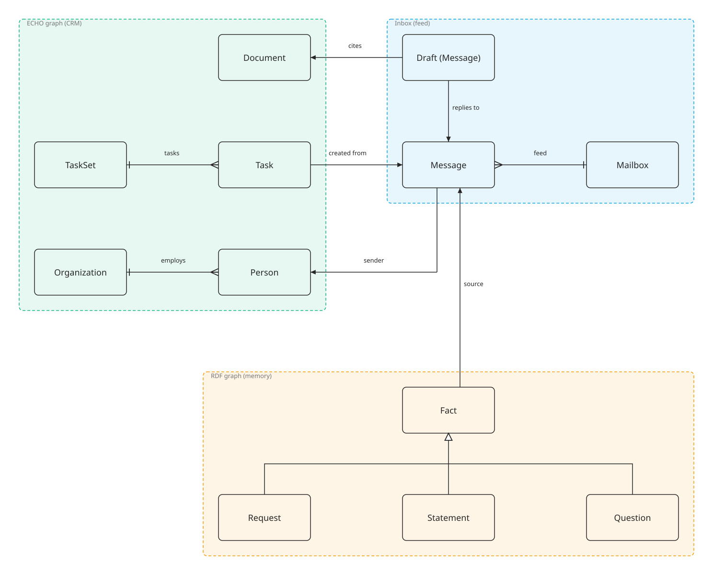

# Customer support demo

Status: approved. Rich accepted the first option of every item in [Decisions](#decisions) on
2026-11-26. The work is the registered project `support-demo`.

## Summary

Developers send messages about Cloudflare Workers. The system records who they are and what they
said, answers what it can from documents it already holds, and gives the rest to people.

- **A draft** is written when a question can be answered from a canonical document in the ECHO graph.
  The draft quotes the passage it relies on and links the document.
- **A task** is created for every request, and for every question that has no such passage.

The demo is one Storybook story of six columns: messages, the pipeline's progress on each message,
facts, CRM objects, draft responses and tasks. It joins pieces that already exist: `@dxos/pipeline`
stages, `@dxos/extractor-lib` identity matching, `@dxos/echo-memory` facts in the space's RDF store,
the `Message`, `Person`, `Organization`, `Task` and `TaskSet` types, and the `storybook-testing`
module layout.

## Data model



<details>
<summary>Diagram source</summary>

```diagram
diagram flow=down
group inbox "Inbox (feed)" {
  node Mailbox "Mailbox" ref="packages/plugins/plugin-inbox/src/types/Mailbox.ts"
  node Message "Message" ref="packages/sdk/types/src/types/Message.ts"
  node Draft "Draft (Message)" ref="packages/sdk/types/src/types/DraftMessage.ts"
}
group echo "ECHO graph (CRM)" {
  node Person "Person" ref="packages/sdk/types/src/types/Person.ts"
  node Organization "Organization" ref="packages/sdk/types/src/types/Organization.ts"
  node Document "Document" ref="packages/plugins/plugin-markdown/src/types/Markdown.ts"
  node TaskSet "TaskSet" ref="packages/sdk/types/src/types/TaskSet.ts"
  node Task "Task" ref="packages/sdk/types/src/types/Task.ts"
}
group rdf "RDF graph (memory)" {
  node Fact "Fact" ref="packages/core/echo/echo-memory/src/Fact.ts"
  node Statement "Statement"
  node Question "Question"
  node Request "Request"
}
edge Mailbox one-to-many Message "feed"
edge Message -> Person "sender"
edge Organization one-to-many Person "employs"
edge Draft -> Message "replies to"
edge Draft -> Document "cites"
edge TaskSet one-to-many Task "tasks"
edge Task -> Message "created from"
edge Fact -> Message "source"
edge Statement extends Fact
edge Question extends Fact
edge Request extends Fact
```

</details>

### Types that exist

Nothing here is new; the demo stores its data in the types the app already uses.

| Concept       | Type                                         | Where it is stored                                      |
| ------------- | -------------------------------------------- | ------------------------------------------------------- |
| Inbox         | `Mailbox` (`@dxos/plugin-inbox/Mailbox`)     | Space; owns a feed                                      |
| Message       | `Message.Message` (`@dxos/types`)            | The mailbox's feed, appended with `Feed.append`         |
| Person        | `Person.Person` (`@dxos/types`)              | Space                                                   |
| Organization  | `Organization.Organization` (`@dxos/types`)  | Space; `Person.organization` refers to it               |
| Document      | `Markdown.Document` (`@dxos/plugin-markdown`) | Space; every document in the space is canonical         |
| Draft         | `DraftMessage` (a `Message` with `properties.mailbox`) | Space; `parentMessage` is the message it answers |
| Task          | `Task.Task` in a `TaskSet.TaskSet` named "Support" | Space                                             |
| Fact          | `Fact.Fact` (`@dxos/echo-memory`)            | The space's memory (RDF), through `FactStoreRegistry`   |

### Fact kinds

A fact's kind is read from its `illocution`; nothing is added to `Fact.Fact`.

```ts
export const FactKind = Schema.Literals(['statement', 'question', 'request']);
export type FactKind = Schema.Schema.Type<typeof FactKind>;

/** Absent or assertive is a statement; a directive is a question when interrogative, else a request. */
export const kindOf = (fact: Fact.Fact): FactKind =>
  fact.illocution?.force !== 'directive'
    ? 'statement'
    : fact.illocution.mood === 'interrogative'
      ? 'question'
      : 'request';
```

| Kind      | `illocution`                                    | Example                                                           |
| --------- | ----------------------------------------------- | ----------------------------------------------------------------- |
| Statement | absent, or `force: 'assertive'`                 | Lumen Labs `is migrating to` Durable Objects                      |
| Question  | `force: 'directive'`, `mood: 'interrogative'`   | Ada `asks` "What is the CPU time limit on the paid plan?"         |
| Request   | `force: 'directive'`, `mood: 'imperative'`      | Ben `requests` "Raise our account's Worker limit to 2,000"        |

Every fact's `attribution.source` is the message's URI and `attribution.agent` is the sender's
`mailto:` IRI, so a fact, its message and its person can be joined in SPARQL.

### Types the demo adds

These live in the stories package. All are Effect Schema, because they are the payloads of the
processor contracts.

```ts
/** One section of a canonical document. */
export const Passage = Schema.Struct({
  document: Schema.String, // The document's DXN.
  title: Schema.String,
  heading: Schema.String,
  text: Schema.String,
});

/** A passage offered as support for a question, with how well it covers the question. */
export const Evidence = Schema.Struct({
  passage: Passage,
  topics: Schema.Array(Schema.String), // The question's topics the document is about.
  coverage: Schema.Number, // 0..1; see the confidence rule.
});

/** What a draft cites. */
export const Citation = Schema.Struct({
  document: Schema.String,
  title: Schema.String,
  heading: Schema.String,
  quote: Schema.String,
});

export const TaskReason = Schema.Literals([
  'request',
  'no-evidence',
  'low-confidence',
  'research-failed',
  'respond-failed',
]);

/** The outcome for one question or request. A draft always carries at least one citation. */
export const Decision = Schema.Union([
  Schema.Struct({
    kind: Schema.Literal('draft'),
    confidence: Schema.Number,
    citations: Schema.NonEmptyArray(Citation),
  }),
  Schema.Struct({
    kind: Schema.Literal('task'),
    confidence: Schema.Number,
    reason: TaskReason,
  }),
]);

export const StageId = Schema.Literals(['ingest', 'entities', 'facts', 'research', 'respond', 'triage']);
/** The same four values as `StatusListStatus` in `@dxos/react-ui-list`. */
export const StageStatus = Schema.Literals(['not-started', 'working', 'success', 'failed']);

/** One message's progress, held in memory and drawn as a card in the pipeline column. */
export const MessageRun = Schema.Struct({
  message: Schema.String, // The message id.
  title: Schema.String,
  stages: Schema.Array(Schema.Struct({ id: StageId, status: StageStatus, detail: Schema.optional(Schema.String) })),
});
```

A draft's citations are stored as a `Cites` relation from the draft to the document, carrying the
quote and heading (decision 5). The draft's body also ends with a "Source" line linking the document,
so the citation is visible wherever the draft is read.

## Pipeline

A `@dxos/pipeline` stream: one envelope per message, six `Stage.map` stages run in order with
`concurrency: 1`, so facts and objects written for one message are visible to the next. The stream is
run with `Pipeline.run`.

| #   | Stage      | Reads                                   | Writes                                                                | Provided by           |
| --- | ---------- | --------------------------------------- | --------------------------------------------------------------------- | --------------------- |
| 1   | `ingest`   | The message from the mailbox feed       | The envelope (text, subject, sender address)                          | The pipeline          |
| 2   | `entities` | The envelope; people and organizations in the space | `Person` and `Organization`, created or matched; the envelope's sender | Entities plugin |
| 3   | `facts`    | The message text; the sender            | Statement, question and request facts in the space's memory           | The pipeline          |
| 4   | `research` | The topics of each question; canonical documents | Evidence per question on the envelope; a `mentions` fact per topic | Research plugin    |
| 5   | `respond`  | Each question and its evidence          | A draft with its `Cites` relations, or a decision to make a task      | Responder plugin      |
| 6   | `triage`   | Each request; each question without a draft | A `Task` in the "Support" task set, naming the message in a foreign key | The pipeline     |

A stage that fails marks its row failed and the message continues. No failure stops the stream. A
failure before `triage` still leaves every request and question with a draft or a task:

- When `facts` cannot store what it read, the facts stay on the envelope, so later stages still see
  the questions and requests.
- When `research` fails, `respond` is skipped and stays not started, and `triage` makes a task with
  the reason `research-failed`.
- When `respond` fails, `triage` makes a task with the reason `respond-failed`.

`triage` itself is the exception. It is the last stage and the only one that creates tasks, so when
its write fails, the requests and unanswered questions of that message have no task. Nothing retries
it: the failed Triage row on the message's card is what tells a person to look. The stream carries on
with the next message.

## Plugins and their contracts

Three plugins each offer one processor. A processor is a contract in the shape the plugin services
design uses (`Service.make` on dxos/dxos#14693): a key, a version, and methods with payload and
success schemas. The pipeline holds only the contract; the plugin that implements it is found at run
time.

```ts
/** Matches a message's sender against the people and organizations in the space, creating what is missing. */
export const EntityExtractor = Contract.make('org.dxos.stories.support.entityExtractor', {
  version: '0.1.0',
  methods: {
    extract: {
      payload: Schema.Struct({ sender: Sender }), // { email, name? }
      success: Schema.Struct({
        person: Schema.optional(Schema.String), // URI of the sender's Person.
        organization: Schema.optional(Schema.String), // URI of the sender's Organization.
        created: Schema.Array(Schema.String), // Labels of the objects made by this call.
        matched: Schema.Array(Schema.String), // Labels of the objects that already existed.
      }),
    },
  },
});

/** Returns what the space's canonical documents say about the topics a question mentions. */
export const Researcher = Contract.make('org.dxos.stories.support.researcher', {
  version: '0.1.0',
  methods: {
    research: {
      // `context` is the rest of the message, read for topics the question does not name itself.
      payload: Schema.Struct({ question: Schema.String, context: Schema.optional(Schema.String) }),
      success: Schema.Struct({ topics: Schema.Array(Schema.String), evidence: Schema.Array(Evidence) }),
    },
  },
});

/** Decides whether a question can be answered from its evidence, and writes the draft when it can. */
export const Responder = Contract.make('org.dxos.stories.support.responder', {
  version: '0.1.0',
  methods: {
    respond: {
      payload: Schema.Struct({
        mailbox: Schema.String, // URI of the mailbox the draft belongs to.
        message: Replied, // { id, subject, created, threadId?, sender }
        question: Schema.String,
        evidence: Schema.Array(Evidence),
      }),
      success: Schema.Struct({ decision: Decision, draft: Schema.optional(Schema.String) }),
    },
  },
});
```

A payload carries plain values (an address, a subject, a URI), never a live object, so every call
can cross a wire unchanged. `Contract.Implementation<C>` derives what a provider implements and the
pipeline calls: one function per method, from the payload's type to an Effect of the result's.

| Plugin    | Contract          | Reuses                                                                                     |
| --------- | ----------------- | ------------------------------------------------------------------------------------------ |
| Entities  | `EntityExtractor` | `buildContactGraph`, `getIdentityIndex` and the identity specs (`@dxos/extractor-lib`)      |
| Research  | `Researcher`      | `Markdown.Document` content; a topic list of Workers product names                         |
| Responder | `Responder`       | `DraftMessage.make`; the confidence rule below                                             |

Each plugin contributes a provider (`{ contract, provide(host) }`) to the multi capability
`SupportCapabilities.Processor`, the mechanism `InboxCapabilities.MailboxProcessor` already uses
(decision 1). The pipeline's host resolves a provider by its contract's key and version, and gives
it the space's database. Each contract is written in the plugin services shape, so moving to
`Service.make` is a change of registration and not of interface.

## Confidence rule

The rule is one pure function, `decide(question, evidence, options)`, with no I/O. It is what the
unit tests cover.

Definitions:

- **Terms.** `terms(text)` lowercases the text, splits on non-alphanumerics, drops stop words, and
  strips a plural `s`.
- **Topics.** A fixed list of Workers product names and their aliases ("Durable Objects" / "DO",
  "KV", "Cron Triggers", "R2", "D1", "Queues", "Hyperdrive", "Logpush", "Wrangler", …). A text's
  topics are the entries whose name or alias occurs in it.
- **Passage.** One heading of a canonical document with the text under it.
- **Canonical document.** A `Markdown.Document` in the space.
- **Coverage.** `|terms(question) ∩ terms(passage)| / |terms(question)|`.

Rule:

1. A request is never answerable. It becomes a task with the reason `request`, whatever the
   documents say.
2. Evidence for a question is every passage of a document whose title names a topic that the
   question, or the rest of its message, mentions. A question with no topic, or with no such
   passage, becomes a task with the reason `no-evidence`.
3. The question's confidence is the highest coverage among its evidence.
4. Confidence at or above the threshold (default `0.5`) gives a draft. It cites the highest-coverage
   passage: the document, the heading, and the passage text as the quote. Below the threshold the
   question becomes a task with the reason `low-confidence`.
5. A draft with no citation cannot be built: `Decision`'s draft member requires a non-empty
   `citations`.

"Answerable from the ECHO graph" therefore means: some passage of a document in the space is about
a topic of the message and covers at least half of the question's terms. A message with a question and
a request produces both a draft and a task.

## Message generators

Each generator is one external person and the messages that person has yet to send. The generator
whose next message is the earliest sends it, so the actors together always send in the order of the
corpus. A message is appended to the mailbox feed and handed to the pipeline: one at a time on demand
(`Step`), or every few seconds while the generators are started.

| Actor       | Address                    | Organization                        | Already in the space                     |
| ----------- | -------------------------- | ----------------------------------- | ---------------------------------------- |
| Ada Okafor  | `ada@lumenlabs.example`    | Lumen Labs                          | The person and the organization          |
| Ben Ruiz    | `ben@lumenlabs.example`    | Lumen Labs                          | The organization only                    |
| Chen Wei    | `chen@northwind.example`   | Northwind                           | Neither                                  |
| Dara Singh  | `dara@quantahealth.example` | Quantahealth                       | Neither                                  |
| Eli Novak   | `eli.novak@gmail.com`      | None (a free-mail address)          | Neither                                  |

The three cases of entity matching are all present: a person who is matched, a person who is created
and joined to an organization that is matched, and a person and organization that are both created.

### Canonical documents

Five documents, seeded into the space, each a few headed sections. Their content is taken from the
Cloudflare documentation as of 2026-11.

| Document                 | Sections                                                                                           |
| ------------------------ | -------------------------------------------------------------------------------------------------- |
| Workers platform limits  | CPU time (10 ms free; 30 s default and up to 5 min paid); memory (128 MB); subrequests (50 free; 10,000 default and up to 10 million paid) |
| Workers KV               | Consistency (eventual; a write can take up to 60 s to show elsewhere); limits (25 MiB value; one write a second per key) |
| Durable Objects          | Alarms (at least once; retried with backoff from 2 s, up to 6 times); storage (10 GB per object on the paid plan) |
| Cron Triggers            | Schedule (UTC); configuration (`triggers.crons`); local testing (`wrangler dev --test-scheduled`)  |
| Secrets                  | Adding a secret (`wrangler secret put`); local development (`.dev.vars`)                           |

### Seed corpus

| #   | From | Message                                                                                             | Outcome                                    |
| --- | ---- | --------------------------------------------------------------------------------------------------- | ------------------------------------------ |
| 1   | Ada  | What is the CPU time limit for a Worker on the paid plan?                                           | Draft, citing Workers platform limits      |
| 2   | Chen | Why did our Worker deploy fail at 14:02 yesterday with error 10021?                                 | Task: `low-confidence`                     |
| 3   | Ben  | Are Durable Object alarms guaranteed to run, and are they retried if the handler throws?            | Draft, citing Durable Objects              |
| 4   | Ben  | Please raise our account's Worker limit to 2,000.                                                   | Task: `request`                            |
| 5   | Chen | How long does a KV write take to be visible in other regions?                                       | Draft, citing Workers KV                   |
| 6   | Dara | Does Hyperdrive pool MySQL connections to an Aurora cluster?                                        | Task: `no-evidence`                        |
| 7   | Dara | Do Cron Triggers run in UTC or in local time?                                                       | Draft, citing Cron Triggers                |
| 8   | Ada  | We are moving our session store to Durable Objects. What is the storage limit per object? Please add Ben to our support plan. | Statement fact; draft; task: `request` |
| 9   | Eli  | What is the largest value I can store in KV?                                                        | Draft, citing Workers KV                   |
| 10  | Dara | Can you enable Logpush for our zone and send us your SOC 2 report?                                  | Task: `request`                            |
| 11  | Ada  | How many subrequests can a Worker make in one request?                                              | Draft, citing Workers platform limits      |
| 12  | Eli  | How do I test a Cron Trigger locally? (research is made to fail for this message)                   | `research` failed; task: `research-failed` |

Seven questions end in a draft and two in a task (one for low confidence, one for no evidence),
three messages carry requests, and one shows a failed stage: seven drafts and six tasks in all. Each
corpus entry states its expected outcomes. A unit test checks every entry against the rule, and a
node test runs the whole corpus through the pipeline on a real ECHO database.

## The story

`stories/stories-support/Support`, in a new private package `@dxos/stories-support`
(`packages/stories/stories-support`). The layout is one `ModuleContainer.Root` of six columns, each
a module surface contributed by `ModuleSurfacesPlugin`, as in `stories-brain` and the plugin
services spike.

| Column    | Lists                                                    | Row                                                                    |
| --------- | -------------------------------------------------------- | ---------------------------------------------------------------------- |
| Messages  | The mailbox feed, newest first                           | Sender and organization; the message's first line                      |
| Pipeline  | One card per message, newest first                       | A `StatusList` of the six stages                                       |
| Facts     | The facts in the space's memory                          | Subject, predicate, object; statement, question or request, and who said it |
| Objects   | People, organizations and documents in the space         | The object's label; its type and address or website                    |
| Drafts    | Draft messages for the mailbox                           | "Re:" and the subject; the document and section the draft cites        |
| Tasks     | The "Support" task set                                   | The task's title; the reason and who asked                             |

Every list is `Listbox` rows from `@dxos/react-ui-list`. The Messages column's toolbar sends one
message (`Step`) and starts or pauses the generators. Reloading the story resets the space.

**Progress in the pipeline column.** A message's card appears with all six rows not started as soon
as the message is appended. The row of the stage being run is working; a finished stage is success
or failed. The card is the `StatusList` from `@dxos/react-ui-list` (dxos/dxos#14703), drawn from the in-memory `MessageRun`
(decision 6). In the running story each stage waits a short time so the working row can be seen; in
tests the wait is zero.

Stories:

- `Default`: the seeded space, generators paused. Start them, or step, to watch messages arrive.
- `Flow`: a play story. It steps message 1 and message 2 and asserts that message 1 ends with a
  draft that cites "Workers platform limits: CPU time" and no task, that message 2 ends with a task
  and no second draft, that both cards show every stage finished, and that the new sender and the
  questions reached the Objects and Facts columns.

## What is real and what is mocked

| Part                          | In the story                                                                                   |
| ----------------------------- | ---------------------------------------------------------------------------------------------- |
| Space, feed, ECHO types       | Real: a client and space from `StoryHarness`                                                   |
| Pipeline                      | Real: `@dxos/pipeline` `Stage.map` and `Pipeline.run`                                          |
| Entity matching               | Real: `buildContactGraph` and the identity index, against the people and organizations in the space |
| Fact store                    | Real: the space's memory, through plugin-brain's `FactStoreRegistry`                           |
| Fact extraction               | Mocked: a recorded extraction per corpus message; a sentence rule (`?` is a question, "please" or "can you" a request) for any other text. The real stage is `extractFactsStage` in `@dxos/pipeline-rdf`, which calls a model |
| Research                      | Mocked: term overlap against the documents in the space. No web search, no model               |
| Responder                     | Mocked: the confidence rule and a template that quotes the passage. No model                   |

Nothing in the story calls a model or the network, so it needs no credentials (decision 3).

Determinism:

- The corpus order, each message's timestamp and each fact's id (a hash of the message id and the
  fact's index) are fixed. Nothing reads the clock or a random source.
- The play story advances with `Step`, never a timer, and waits on rows by test id.
- The confidence rule and the corpus's expected outcomes are unit tests that need no browser.

## Phases

### Phase 1: the pipeline answers from documents

Everything above. The Responder is a rule: it answers only what a passage in the space covers, and
everything else becomes a task for a person.

### Phase 2: an agent answers, and delegates research to other agents

Rich added this on 2026-11-26. It is not built in phase 1; this section records the direction.

The Responder becomes an agent. When a question has no passage that answers it, the agent does not
give up at once: it delegates research to other agents, and answers once one of them finds the
answer. Only a question that research cannot answer becomes a task for a person.

- **The responder is a session.** It runs as a `SessionProcess` and receives each question through
  the same `Responder` contract, so the pipeline does not change.
- **Research is delegated, not called.** For each line of enquiry the responder creates a research
  `Task` and assigns it to a receiver through `AgentService`, as the `org.dxos.agent-delegation` spec
  describes: a thread of its own for a light lookup, another session for a separate line of work,
  another agent when its permissions or specialization are needed. The task, not a message, is the
  control plane.
- **Research agents specialize.** One reads the canonical documents, one queries the RDF graph for
  what the same organization or other customers were told before, and one searches outside the
  space. Each is a provider of the `Researcher` contract, so phase 1's Research plugin is the first
  of them.
- **A research task ends with evidence.** The receiver attaches what it found to the task as
  `Evidence` and closes it. The responder applies the confidence rule to the evidence of all its
  research tasks, then writes a draft that cites it or makes a task for a person with what was
  tried.
- **The story shows the delegation.** A message's `respond` row opens into its research tasks, each
  with its own status and the agent it was given to. These are real `Task` objects, so the card for
  them is `TaskProgress`, and the Tasks column separates work given to agents from work given to
  people.

Open questions for phase 2:

1. Whether evidence from outside the space may be cited in a draft, or may only start a task. Phase
   1's rule is that a draft cites a document in the space.
2. Whether a research agent that finds an answer also writes it into the space as a new canonical
   document, so the next question is answered by phase 1's rule.
3. How long the responder waits for research before it makes a task for a person.

## Decisions

Rich accepted the first option of each on 2026-11-26.

1. **How a plugin offers its processor.**
   1. A multi capability now, with each contract written in the plugin services shape. dxos/dxos#14693
      is not merged and its `Service` module is inside a stories package, so it cannot be imported.
   2. Stack this work on dxos/dxos#14693 and provide the processors with `Service.make` and
      `ServiceHost`.
   3. A plain capability with a TypeScript interface and no schemas.
2. **Register this as a project** (`/dxos:project new support-demo`).
   1. Yes: the demo will grow over several sessions.
   2. No.
3. **Models and search.**
   1. Deterministic processors now; a provider that calls a model is added later behind the same
      contracts.
   2. Use the real `extractFactsStage` and a model-written reply now, with memoized fixtures. This
      needs a live model run to record them.
4. **The inbox.**
   1. A `Mailbox` and its feed, as plugin-inbox stores mail, so the real mailbox views and the brain
      pipeline can be put on the same data later.
   2. Plain `Message` objects in the space.
5. **Where a draft's citations are stored.**
   1. A `Cites` relation from the draft to the document, defined in the stories package.
   2. A `citations` entry in the draft's `properties`.
6. **The pipeline card.**
   1. `StatusList` over in-memory run state. Stage runs are not work items and do not belong among
      the tasks.
   2. `TaskProgress` over a persisted `Task` per stage, in a task set of its own.

Defaults taken without asking: the package name `@dxos/stories-support`; the confidence threshold
`0.5`; every document in the space is canonical; a request always becomes a task.
