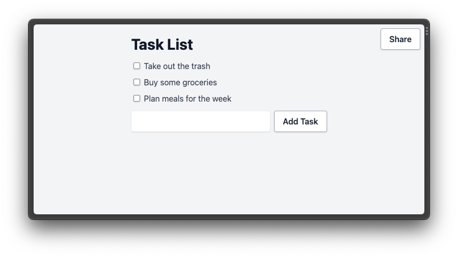
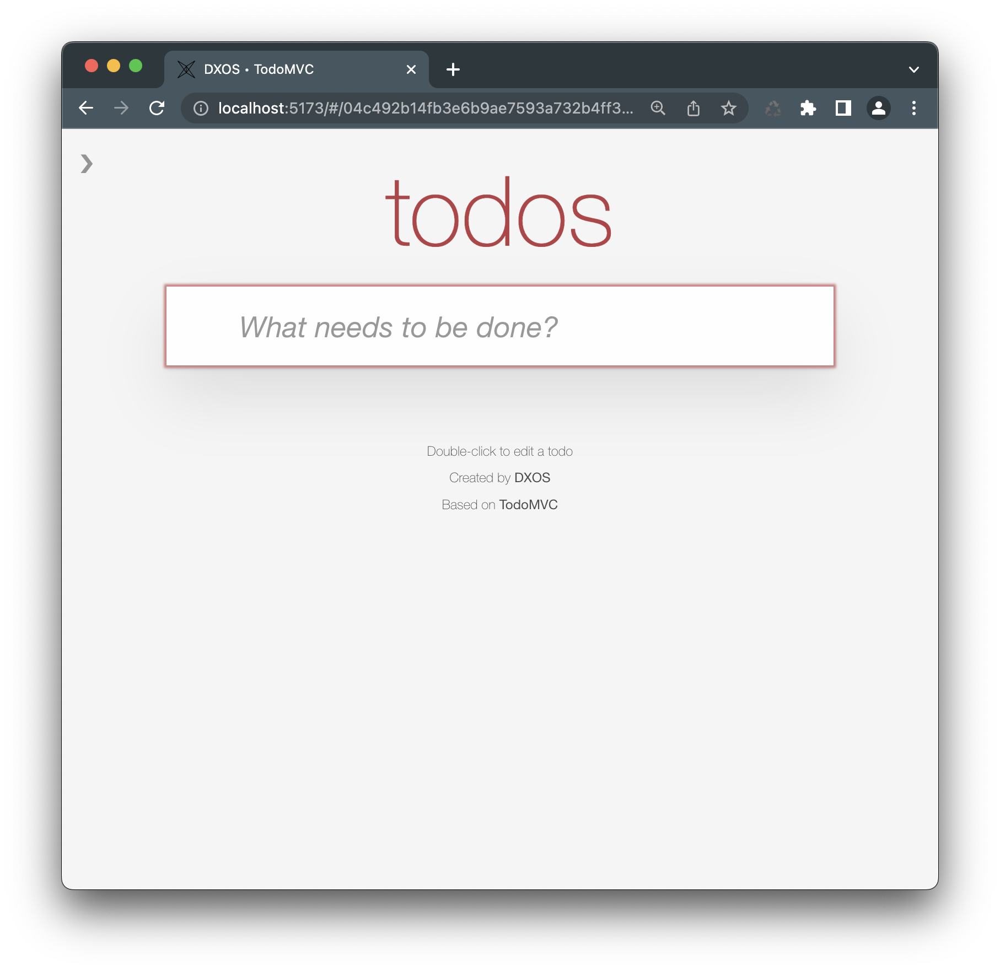
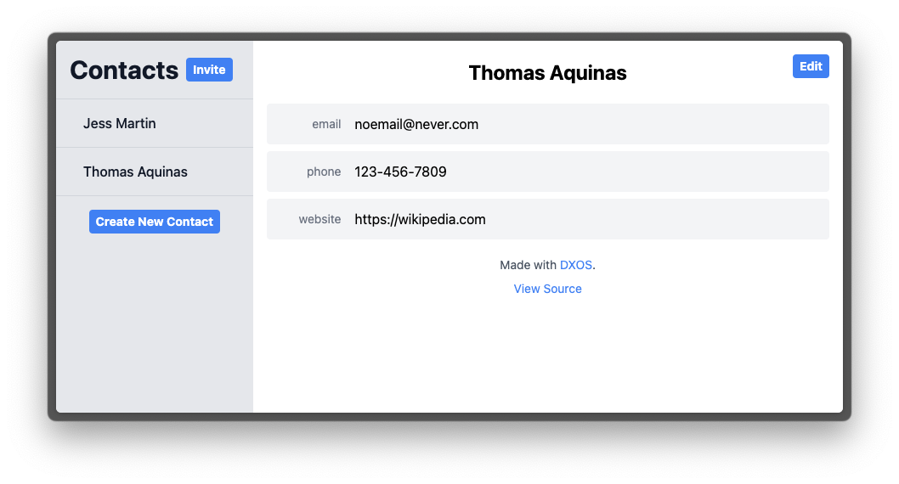
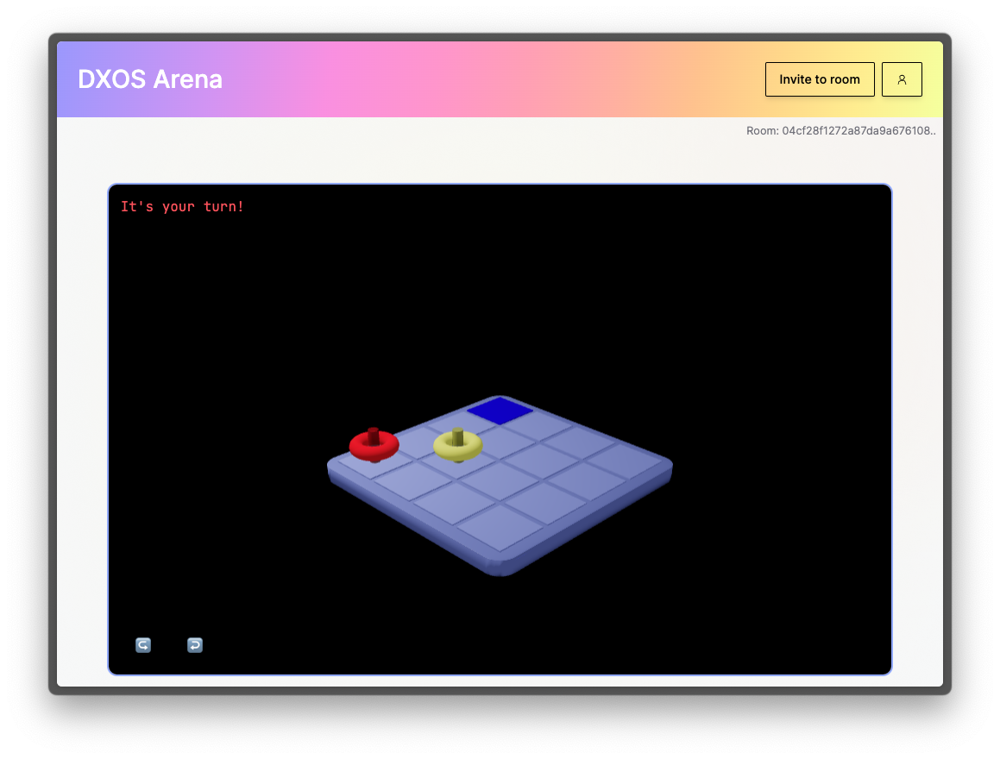

### Composer

Composer is a local-first workspace designed for collaboration in small teams.

* Learn more about [Composer](https://dxos.org/composer)
* Try [Composer](https://composer.space)
* Code on [Github](https://github.com/dxos/dxos/tree/main/packages/apps/composer-app)

### Tasks

Tasks is a simple tasks app.

* Code on [Github](https://github.com/dxos/dxos/tree/main/packages/apps/tasks)
* Run [Tasks](https://tasks.dxos.network) on `dxos.network`
  

### TodoMVC

TodoMVC is a fork of the [TodoMVC](https://todomvc.com/) sample.

* Code on [Github](https://github.com/dxos/dxos/tree/main/packages/apps/todomvc)
* Run [TodoMVC](https://todomvc.dxos.network) on `dxos.network`
  

### Contacts

Contacts is a simple contacts manager.

* Code on [Github](https://github.com/dxos/contacts-app)
* Run [Contacts](https://contacts.dxos.network) on `dxos.network`
  

### Game Arena

Game Arena is a collaborative game arena with Chess and 3D Connect 4.

* Code on [Github](https://github.com/dxos/arena)
* Play [Arena](https://arena.dxos.network) on `dxos.network`
  
