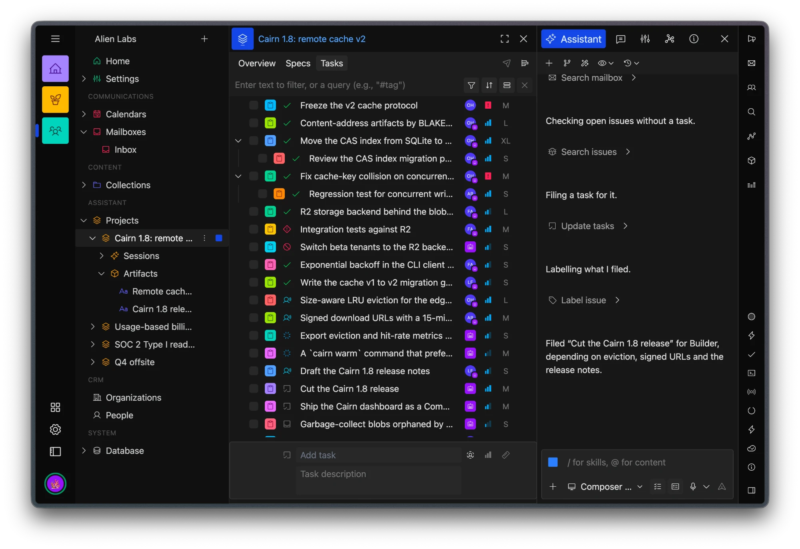
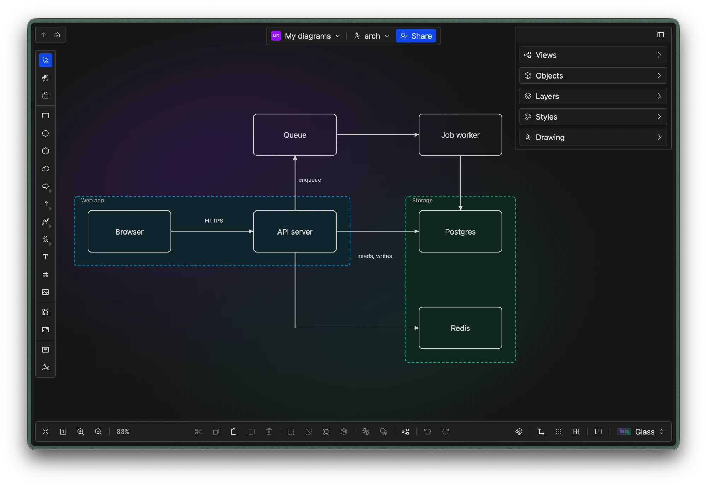
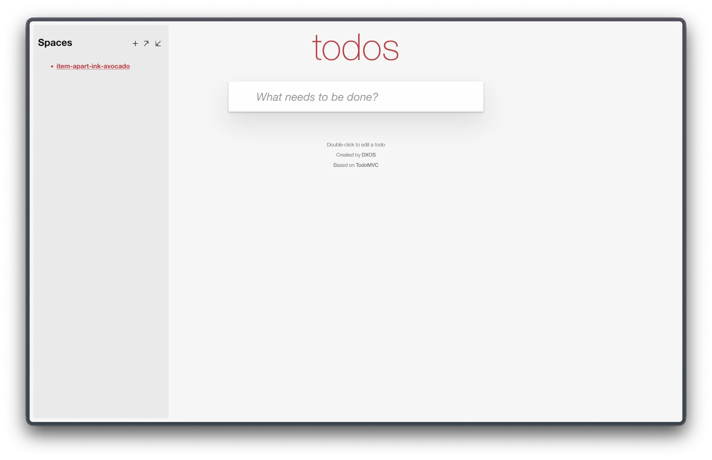
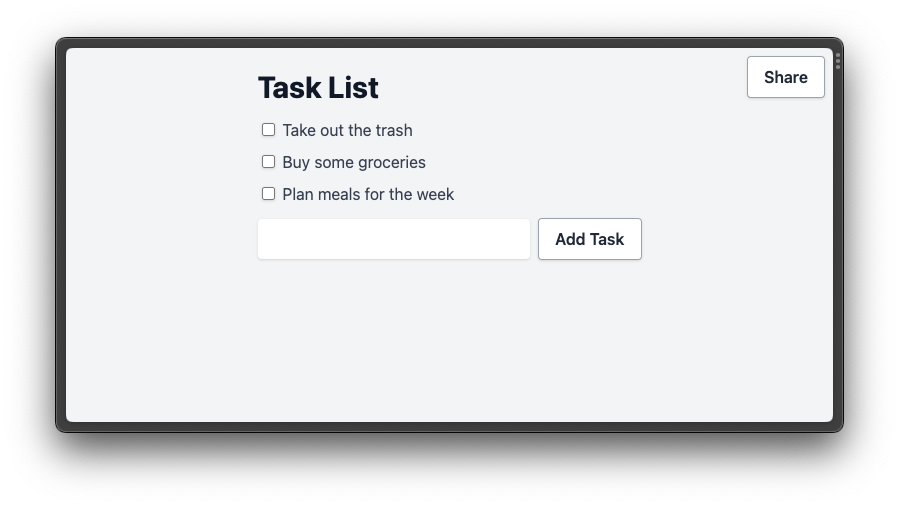
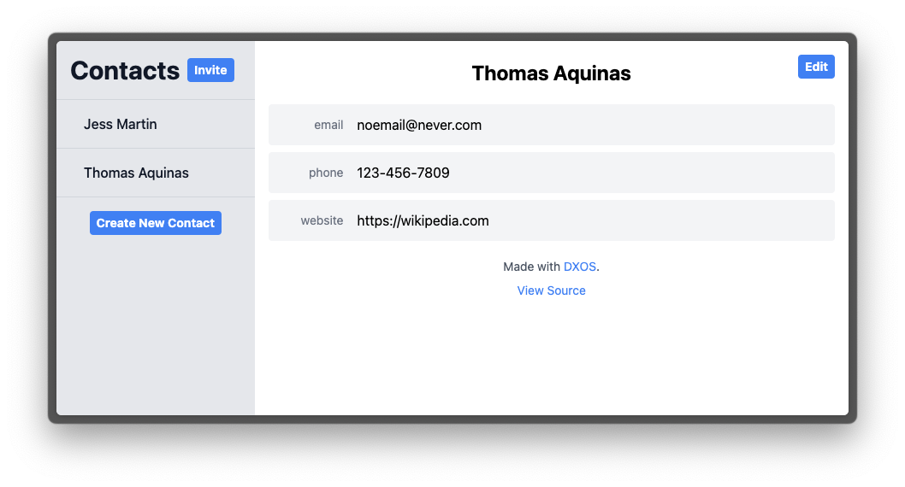
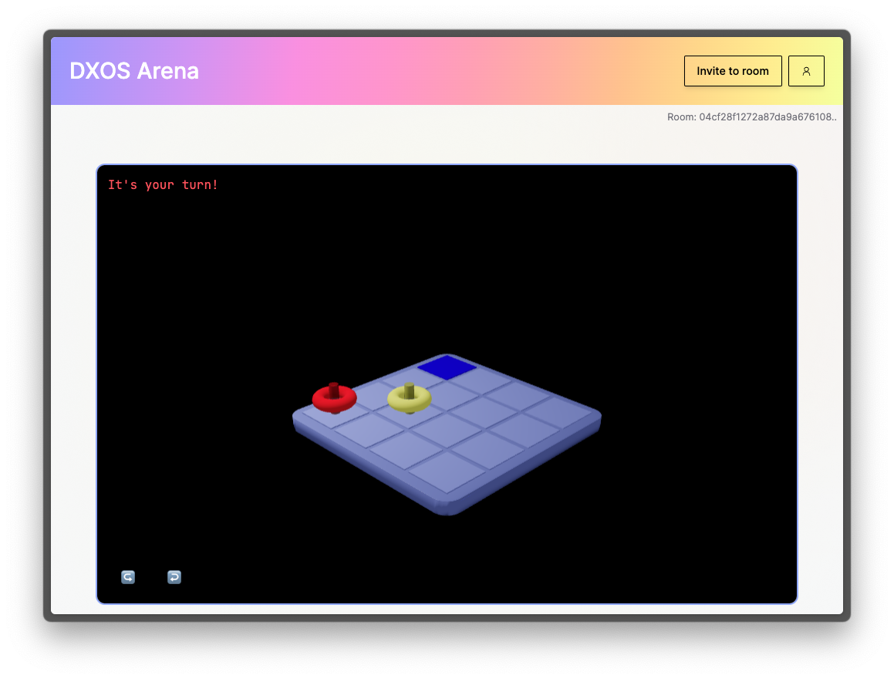

This page lists apps built on ECHO, each with its code and, where one runs, a live link.

### Composer

Composer is a local-first workspace designed for collaboration in small teams. It is the flagship app built on ECHO.

* Learn more about [Composer](https://dxos.org/composer)
* Try [Composer](https://composer.space)
* Code on [GitHub](https://github.com/dxos/dxos/tree/main/packages/apps/composer-app)
  

### drawing.sh

drawing.sh is a diagramming app on one full-screen canvas. It makes an anonymous identity on first run, keeps diagrams
in spaces and shares a space with a link. drawing.sh and Composer are both built with ECHO and use the same network, so
they are compatible.

* Learn more about [drawing.sh](https://drawing.sh)
* Try [drawing.sh](https://app.drawing.sh)
* Code on [GitHub](https://github.com/dxos/dxos/tree/main/packages/apps/drawing-app)
  

### TodoMVC

TodoMVC is a fork of the [TodoMVC](https://todomvc.com/) sample. It shows a familiar app whose todos are ECHO objects
in a space you can share.

* Code on [GitHub](https://github.com/dxos/dxos/tree/main/packages/apps/todomvc)
* Run [TodoMVC](https://todomvc.dxos.network) on `dxos.network`
  

### Tasks

Tasks is a task list. It shows a query that keeps a list current, and a space shared by invitation.

* Code on [GitHub](https://github.com/dxos/dxos/tree/main/packages/apps/tasks)
* Run [Tasks](https://tasks.dxos.network) on `dxos.network`
  

### Contacts

Contacts is a contacts manager. Its code is in a repository of its own, so it shows a DXOS app built outside the DXOS
repository.

* Code on [GitHub](https://github.com/dxos/contacts-app)
* Run [Contacts](https://contacts.dxos.network) on `dxos.network`
  

### Game Arena

Game Arena lets people play Chess and 3D Connect 4 together.

* Code on [GitHub](https://github.com/dxos/arena)
* Play [Arena](https://arena.dxos.network) on `dxos.network`
  
