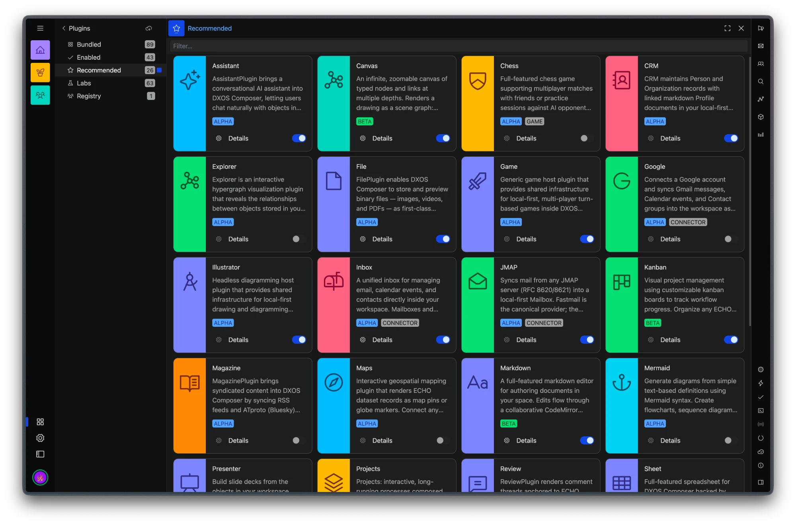
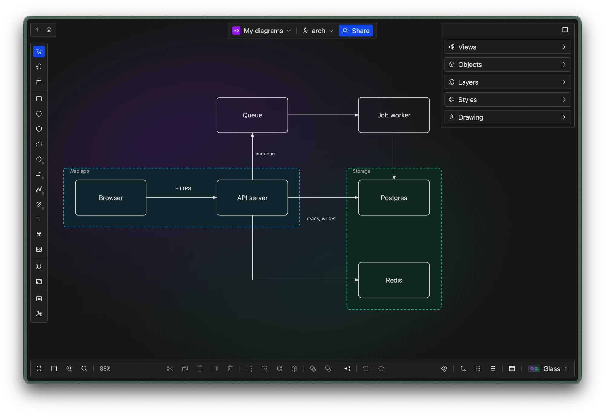
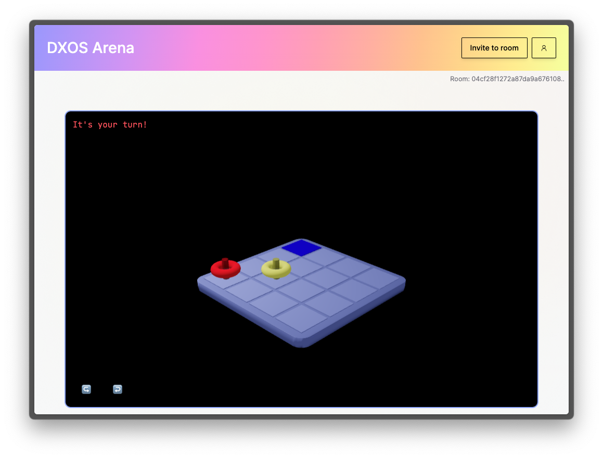

This page lists apps built with PLEX, each with its code and a live link.

### Composer

Composer is a local-first workspace designed for collaboration in small teams. Its features are PLEX plugins.

* Learn more about [Composer](https://dxos.org/composer)
* Try [Composer](https://composer.space)
* Code on [GitHub](https://github.com/dxos/dxos/tree/main/packages/apps/composer-app)
  

### drawing.sh

drawing.sh is a diagramming app on one full-screen canvas. It runs a few of Composer's plugins, such as the client,
space and illustrator plugins, and swaps Composer's deck for a layout plugin of its own. drawing.sh and
Composer are both built with ECHO and use the same network, so they are compatible.

* Learn more about [drawing.sh](https://drawing.sh)
* Try [drawing.sh](https://app.drawing.sh)
* Code on [GitHub](https://github.com/dxos/dxos/tree/main/packages/apps/drawing-app)
  

### Game Arena

Game Arena lets people play Chess and 3D Connect 4 together. It is built on an early release of the app framework that
became PLEX, so its plugin code predates the current API.

* Code on [GitHub](https://github.com/dxos/arena)
* Play [Arena](https://arena.dxos.network) on `dxos.network`
  
