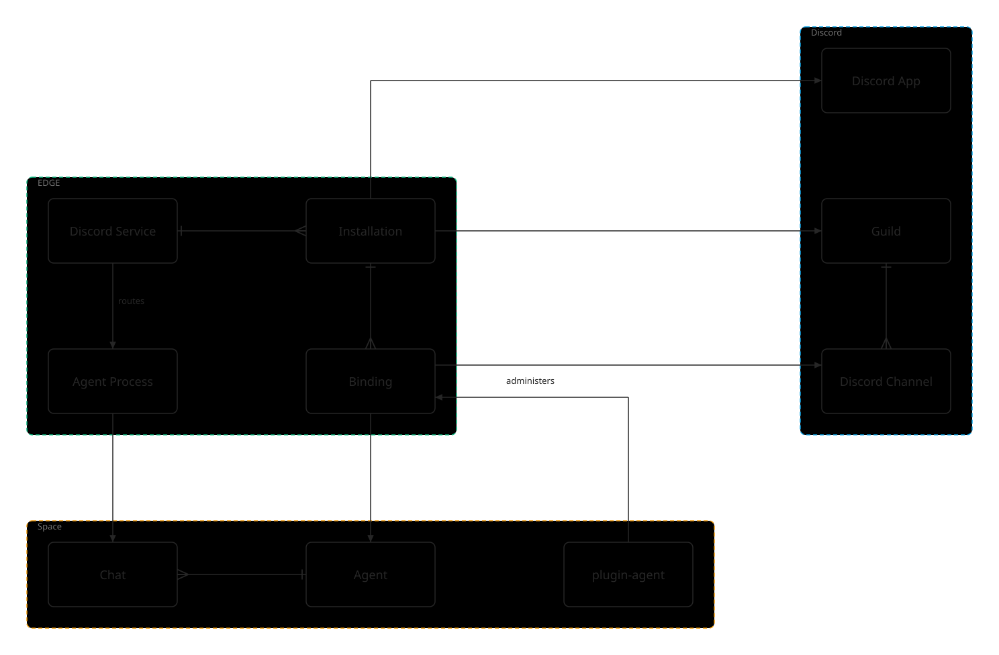

# Agents on Discord — product design

**Status:** proposal (2026-10-11). Nothing here is built beyond what [§ Today](#today) describes.

Other teams should be able to put DXOS agents in their Discord servers in two ways:

1. **Zero development.** Install the DXOS Discord app, then map Discord channels to agents in Composer.
2. **Developer kit.** Register their own Discord app (their own name, avatar and Discord review) and run it on the
   same EDGE service, extending the agents with their own skills.

Both run on one shared EDGE service. The hard part is not the plumbing but authority: binding a Discord channel to an
agent needs a person who can prove control of both sides.

Source: [diagrams/discord-agents.dx](./diagrams/discord-agents.dx), rendered with plugin-illustrator.

## Discord's constraints

These decide the shape of everything else.

- **An app is one member per guild.** A guild (Discord's API name for a server) contains channels, members and roles.
  An app's bot user joins a guild once; it can carry a different nickname in each guild, but never two names in the
  same guild.
- **Apps are made by hand.** There is no public API to create a Discord application; each one is registered in the
  Developer Portal, which issues its id and bot token.
- **Privileged intents are per app.** Reading message content needs the Message Content intent, which Discord reviews
  for every app in more than 100 guilds.
- **Access to a channel is a permission, not an event.** Nothing tells the bot "you were added to #support"; it can read
  whatever its role is allowed to read. Mapping a channel to an agent must be an explicit act.
- **A slash command is authenticated by Discord.** When a member runs one, Discord tells the app who they are and what
  they may do in that guild, with no OAuth flow.

## Model

| Object            | What it is                                                                                                                       | Key                   | Where |
| ----------------- | -------------------------------------------------------------------------------------------------------------------------------- | --------------------- | ----- |
| **App**           | A registered Discord application: the DXOS app ("Kai"), or a team's own. Token held by KMS, never in a space.                    | application id        | EDGE  |
| **Installation**  | An app installed in a guild, and the Discord user who installed it (linked to their DXOS identity).                              | (app, guild)          | EDGE  |
| **Binding**       | A Discord channel mapped to an agent in a space, with who authorized each side.                                                  | (app, guild, channel) | EDGE  |
| **Agent**         | The ECHO agent: instructions, skills, modes, memories. One agent may be bound to many channels and shares its state across them. | space, object id      | space |
| **Chat**          | One conversation: a Discord thread or DM, under the agent (`ensureChannelChat`).                                                 | (channel, thread)     | space |
| **Agent process** | The turn loop for one chat.                                                                                                      | chat                  | EDGE  |

The **Discord service** is today's per-app bot host generalized: one gateway connection per app across every guild it
is in, a binding table instead of a single config, and tokens from KMS.

## Authority

A binding joins two systems, so it needs two proofs, made by the same person in one flow:

| Side                           | Proof                                                                        | Checked by                                                |
| ------------------------------ | ---------------------------------------------------------------------------- | --------------------------------------------------------- |
| Discord: the guild and channel | the user has Manage Server in the guild (or Manage Channels on that channel) | Discord OAuth (`identify` + `guilds`), or a slash command |
| DXOS: the space and agent      | the user is a member of the space allowed to add agents                      | EDGE, from the user's HALO credentials                    |

EDGE records who proved each half and when. Either side can revoke a binding, and a binding whose channel the bot can
no longer read is inert.

**The agent must be a member of its space.** To act in the space from EDGE, the agent needs its own identity there,
granted by the space owner (the agent DID the Identity panel shows as "No DID provisioned" today). Binding a channel
requires it, or asks the owner to grant it.

## Flows

### Install

From plugin-agent: **Add to Discord** opens the app's OAuth install link (`bot` + `identify`, redirect to EDGE).
Discord returns the guild and the installing user; EDGE creates the Installation and links that Discord user to the
signed-in DXOS identity. A team's own app is first registered with the service (application id, bot token to KMS,
interactions public key), which gives it an install link of its own.

### Administer channels and agents (plugin-agent)

All administration lives in plugin-agent, once the user has authenticated to Discord:

1. **Connect Discord** (OAuth `identify` + `guilds`): the user's guilds, with the permission bits that show which
   ones they may administer.
2. Per guild where the app is installed: its channels, read through the bot, each showing the agent it is bound to.
3. **Bind** a channel to one of the agents in a space the user belongs to; **Unbind**; set the app's nickname for the
   guild.

A slash command (`/connect`, run in the channel by a guild admin) can start the same flow from Discord: the bot answers
privately with a short-lived link that opens plugin-agent at step 3. It needs no OAuth, so it is the lightest path for
zero-development teams.

### Route a message

The gateway delivers it; the service drops it unless its channel is bound and it addresses the app (a mention of the
app or its role, the agent's name, a reply, or a thread the agent is in); the binding names the agent; the chat for
the thread runs a turn; the reply is posted back. This is today's pipeline with the binding lookup in place of the
single config.

## Names: Kai as concierge

Because an app is one member per guild, a team with several agents in one guild sees one name. The proposal: **the app
is a concierge, and the agents speak for themselves.**

- **Kai is the member.** It is what people mention, reply to and DM, and what holds the bindings.
- **Kai routes.** In a channel bound to one agent, the message goes straight to it. In a channel bound to several (or a
  DM), Kai picks the agent from the question and the agents' descriptions, or asks; "@Kai ask Ada about billing"
  names one directly.
- **Agents answer under their own names** through a channel webhook (below), so a reply reads as "Ada", not "Kai".

### Webhooks

A webhook posts a message with a `username` and `avatar_url` chosen per message, into a channel or a thread
(`thread_id`). The bot creates one per bound channel (it needs Manage Webhooks) and keeps its URL in KMS.

| For                                                                                  | Against                                                                                                                                                                         |
| ------------------------------------------------------------------------------------ | ------------------------------------------------------------------------------------------------------------------------------------------------------------------------------- |
| Each agent's own name and avatar on every reply, even several agents in one channel. | The persona is not a member: it cannot be mentioned, DMed, or found in the member list. People address Kai.                                                                     |
| No extra Discord apps, and no extra Message Content review.                          | A reply to a persona's message references the webhook, not the bot: the service must treat its own webhook ids as "the bot" when checking whether a message is addressed to it. |
| Works in threads and forum channels.                                                 | No DMs: a DM is always answered as Kai.                                                                                                                                         |
| Messages can be edited and deleted through the webhook.                              | Kai's own actions still show as Kai: typing, reactions, starting a thread.                                                                                                      |
|                                                                                      | Messages carry Discord's app badge, and webhooks count against a per-channel limit.                                                                                             |
|                                                                                      | A webhook URL lets anyone post as it: it must be kept in KMS and rotated if leaked.                                                                                             |

Webhooks fit the concierge model: people talk to Kai, the right agent answers by name. A team that wants each agent to
be a full member (mentionable, DM-able) registers one app per agent through the developer kit instead.

## Developer kit

What a team gets by bringing its own app:

- **Its own identity:** name, avatar and Discord review are theirs; one app per agent they want as a full member.
- **The same service:** registered once, it runs on the shared gateway host with the same bindings and flows.
- **Agent extensions:** skills and operations (`Skill.make`, `Operation.make`) bound to their agents, and slash commands
  declared by the app and handled by an operation.

Open: whether the kit also lets a team run its own code that receives Discord events (their gateway or interactions
endpoint calling the agent API), or only extends the agent that the shared service runs.

## Today

What is built (dxos/dxos#13887, dxos/edge#1279), set up from the agent's **Discord** companion and prototyped in the
`stories-agent` `AgentDiscord` stories:

- **Connect Discord** signs in with the `discord-user` connector (OAuth `identify` + `guilds`) and lists the servers the
  user administers; **Install** (or **Reinstall**, to grant permissions added since) opens the bot's install link.
- One bot host per app on EDGE (`DiscordBot`, `bot:<applicationId>`) with a **binding table**: many Discord channels,
  each routed to a `Channel` in one owning space. A binding from another space is refused (409) instead of taking
  the bot over.
- The bot token and application id live on the space's `DiscordChannel` config; locally EDGE uses its own
  `DISCORD_BOT_TOKEN_DEV`, and the routes that need the token (listing channels, deleting a thread) run on EDGE.
- No installation records, KMS-held tokens, slash commands or webhooks yet.

### How a Discord channel reaches an agent

Connecting a channel (`DiscordAdminOperation.BindChannel`, the companion's **Connect**) writes three things:

| Where | Object                        | What it holds                                                                                                     |
| ----- | ----------------------------- | ----------------------------------------------------------------------------------------------------------------- |
| space | `Channel` (backend `discord`) | One per agent, bot and server; its `DiscordChannel` config names the bot, the server and the Discord channel ids. |
| space | `AgentChannels`               | The agent's list of `Channel`s; the server's `Channel` is added to it the first time.                             |
| EDGE  | binding in `DiscordBot`       | Discord channel id → the owning space, the `Channel`'s EID and its config's EID.                                  |

The binding does not name the agent: EDGE resolves it per message as the agent whose `AgentChannels` lists the
binding's `Channel`, so the space stays the authority on which agent answers.

When someone posts in a bound channel:

1. The gateway delivers the message; the bot host looks up the binding by channel id, or by the parent channel for a
   thread.
2. A message not addressed to the bot (a mention of it or its role, its name, a reply to it, or a thread it is in) is
   kept as context for the next turn and goes no further.
3. Otherwise the bot host finds or creates the agent's chat for that conversation, keyed by
   `AgentChannels.chatKey(channelId, thread)` with the `Channel`'s object id; a message in the channel itself starts a
   thread.
4. The agent runs a turn in the space, and its reply is posted back through the bot.

**Disconnect** (`UnbindChannel`) deletes the binding and removes the id from the config's channel list; the `Channel`
stays in the agent's list. Deleting a thread conversation in the Activity panel deletes the Discord thread through EDGE
(the bot needs Manage Threads) and then the chat.

## Phases

1. **Bindings.** Built: the bot host routes by binding, and a claim from another space is refused. Still to do:
   Installation records. (edge, plugin-agent)
2. **Administration in plugin-agent.** Built: Connect Discord (OAuth), list servers and channels, connect and
   disconnect. Still to do: the nickname, and tokens in KMS for sending as well as receiving.
3. **Concierge and webhooks.** Kai routes among a channel's agents; agents reply through webhooks under their own
   names.
4. **Developer kit.** App registration, slash commands handled by operations, and the decision on custom event handlers.

## Open questions

1. Which Discord permission authorizes a binding: Manage Server, or Manage Channels on the channel?
2. Is `/connect` in Discord needed in phase 2, or is administration in plugin-agent enough at first?
3. May one channel be bound to several agents (concierge routing), or one agent per channel?
4. Developer kit scope: their app on our service plus agent extensions, or also their own event handlers?
