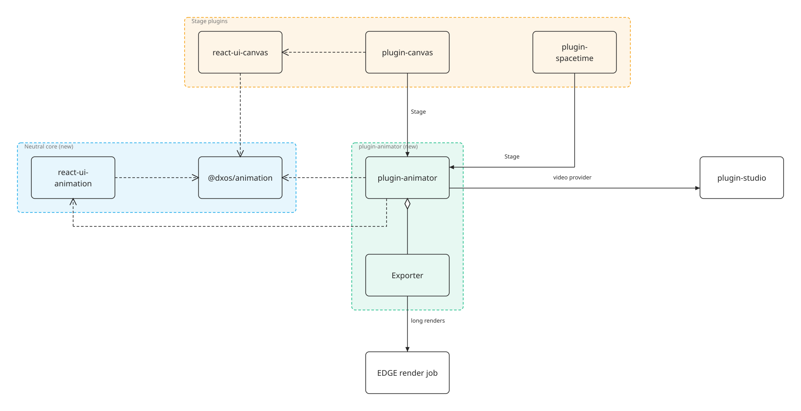

# plugin-animator — Design

Status: draft for review (2026-10-27). Nothing here is built. After this design is approved, the requirements move
into `PLUGIN.mdl` and the build steps into `TASKS.md`.

## 1. Goal

Make animation a capability of Composer rather than a feature of one plugin. A user (or an agent) builds a film from
objects that other plugins own — a canvas drawing, a 3D scene — by keying their properties on a timeline, adds
scripted effects that no keyframe can express, plays it, and renders it to a video clip that plugin-studio can use.

Three things have to be true for that:

1. **The animation engine is plugin-neutral.** Timelines, keyframes, easing, the clock, the timeline UI and the
   sandbox that runs agent-written effects live in shared packages, not in `react-ui-canvas`.
2. **Plugins that own objects supply the stage.** The animator never learns what a canvas node or a 3D mesh is. A
   _stage plugin_ tells it which properties of its objects can be animated, applies sampled values, and renders the
   result.
3. **Rendering is deterministic.** Frame n is drawn because the clock was set to t = n / fps, so live playback,
   scrubbing and export agree, whether the export runs in the browser, on the desktop or on EDGE.

Not in scope: audio mixing (plugin-studio and plugin-recorder own audio), a curve editor, physics engines, and
several people editing one timeline at once.

## 2. What exists today

Most of the engine already exists, but in the wrong place, and the 3D side has none of it.

| Capability                                                                                                     | Where                                                                          | Coupling                                                                  |
| -------------------------------------------------------------------------------------------------------------- | ------------------------------------------------------------------------------ | ------------------------------------------------------------------------- |
| `Easing`, `Keyframe`, `Track`, `Timeline` schemas                                                              | `packages/ui/react-ui-canvas/src/model/types.ts`                               | Neutral in shape; targets are canvas node ids                             |
| Easing, interpolation, key editing, path helpers                                                               | `react-ui-canvas/src/model/timeline.ts`                                        | Neutral (pure), except `sampleView` and the 2D camera keys                |
| One clock per view, seekable for export (`__DX_SCENE_CLOCK__`, `data-frame-time`)                              | `react-ui-canvas/src/model/clock.ts`, `hooks/useClock.ts`                      | Neutral                                                                   |
| Timeline bar (play, scrub, key diamonds, timecode)                                                             | `react-ui-canvas/src/components/panels/TimelinePanel/`                         | Nearly neutral (props only)                                               |
| Animatable property marker                                                                                     | `AnimatableAnnotationId` (a raw key) + `animatableProperties()`                | Mechanism neutral; does not serialize with stored schemas                 |
| Auto-key (edits away from t = 0 become keys)                                                                   | `react-ui-canvas/src/engine/animate.ts`                                        | Canvas intents and projections                                            |
| Generators: agent-written effects, compiled with esbuild-wasm, run in a worker, deterministic with checkpoints | `react-ui-canvas/src/generator/`; ECHO type and operations in `plugin-canvas`  | Sandbox neutral; drawing model (`Shape`, `GeneratorContext`) is 2D canvas |
| Seek-based frame export to video                                                                               | `react-ui-canvas/scripts/render-story.mjs`                                     | Standalone (Playwright + ffmpeg)                                          |
| 3D modelling                                                                                                   | `plugin-spacetime` (Babylon.js + manifold-3d); `plugin-terra` (Babylon)        | No animation, no clock                                                    |
| 3D presentation with effects (packet flow, particle bursts, conversations) and a virtual-clock recorder        | `tools/autocue/showcase/echo3d` (Three.js)                                     | Standalone, inline, not deterministic                                     |
| Clip container and media producers                                                                             | `plugin-studio`: `MediaArtifact`, `Variant`, `Storyboard`, `GenerationService` | Neutral                                                                   |

`react-ui-canvas/docs/ANIMATION.md` is the design this builds on. Its phases 1 and 2 are built; its phase 4
("`animatable` annotations for host types") and open question 6 ("export on EDGE or local only") are what this
design answers.

## 3. Decisions

| #   | Decision                                                                                                                                                                                                                       | Why                                                                                                                                                   |
| --- | ------------------------------------------------------------------------------------------------------------------------------------------------------------------------------------------------------------------------------ | ----------------------------------------------------------------------------------------------------------------------------------------------------- |
| 1   | **Factor the neutral engine out of `react-ui-canvas` into `@dxos/animation` (model, clock, effect runtime) and `@dxos/react-ui-animation` (timeline UI, hooks).** react-ui-canvas imports them; no re-exports are left behind. | It is the code that already works. Moving it is cheaper than a second engine and keeps canvas behaviour identical.                                    |
| 2   | **An `Animation` is its own ECHO object that references the objects it animates**, rather than data inside one plugin's document.                                                                                              | A film can span objects from several plugins (a canvas scene, then a 3D scene), and the same object can appear in several films without being edited. |
| 3   | **Stage plugins implement a `Stage` capability**: list animatable properties, apply sampled values, render.                                                                                                                    | Keeps the animator ignorant of every object model; a new plugin becomes animatable by contributing one capability.                                    |
| 4   | **Animatable properties are declared with a serializable ECHO annotation** (`Annotation.make`), replacing the raw `AnimatableAnnotationId` key.                                                                                | A stored or user-defined schema keeps the marker, so the animator can list properties of types it has never seen.                                     |
| 5   | **Effects generalise canvas generators**: agent-written, sandboxed, deterministic code, with a context and output type per renderer (2D shapes, 3D instances, DOM overlays).                                                   | One sandbox, one determinism contract, one set of agent operations, three ways to draw.                                                               |
| 6   | **One clock contract for every renderer**: the animator owns the clock; a stage draws the frame for the time it is given and marks it drawn.                                                                                   | Live playback, scrubbing and export show the same frame for the same time (ANIMATION.md §2.1).                                                        |
| 7   | **3D stages use Babylon.js**, the engine plugin-spacetime and plugin-terra already ship. echo3d's effects are ported to it; echo3d stays a prototype.                                                                          | Two 3D engines in one bundle cost size and duplicate tooling. Babylon already has the CAD and planet work behind it.                                  |
| 8   | **Export in the app first (WebCodecs), then on EDGE**, with the local CLI kept for CI and development.                                                                                                                         | WebCodecs encodes in the browser and the desktop webview with no native dependency. EDGE takes renders too long to run in a tab.                      |
| 9   | **A rendered animation reaches plugin-studio as a `video/mp4` Variant from a `GenerationService` provider.**                                                                                                                   | Studio already models clips as Variants and long jobs as enqueue/await with a persisted `jobId`.                                                      |

## 4. Architecture



The neutral core has no idea what it animates. plugin-animator owns the `Animation` object, the editor and export.
Stage plugins depend on plugin-animator's capability types and contribute a `Stage` each; plugin-canvas keeps its
own engine in react-ui-canvas, which now builds on `@dxos/animation`.

| Package                             | Holds                                                                                                                                                                                                                                                                              | New or moved                                                               |
| ----------------------------------- | ---------------------------------------------------------------------------------------------------------------------------------------------------------------------------------------------------------------------------------------------------------------------------------- | -------------------------------------------------------------------------- |
| `@dxos/animation`                   | `Easing`, `Keyframe`, `Track`, `Timeline` schemas; `ease`, `interpolate`, `trackValue`, key editing, path helpers; `AnimatableAnnotation` and `animatableProperties`; the `Clock` (Atoms, seek contract); the effect runtime (compile, worker, runner, checkpoints, seeded random) | Moved from react-ui-canvas, plus value kinds for colour, vec3 and rotation |
| `@dxos/react-ui-animation`          | `Timeline` bar (collapsed) and expanded track rows; `useClock`, `useExposedClock`; keyboard model                                                                                                                                                                                  | Moved from react-ui-canvas, then extended                                  |
| `plugin-animator`                   | `Animation` ECHO type, `AnimatorArticle`, `Stage` and `Effect` capabilities, operations and skill, exporter, studio provider                                                                                                                                                       | New                                                                        |
| `react-ui-canvas` / `plugin-canvas` | Canvas engine; contributes the canvas `Stage`                                                                                                                                                                                                                                      | Imports the core; generators become 2D effects                             |
| `plugin-spacetime`                  | 3D scene; contributes the 3D `Stage`                                                                                                                                                                                                                                               | Gains a clock-driven render path and animatable annotations                |

## 5. Data model

### 5.1 Animation

An `Animation` is a sequence of **shots**. Each shot plays one stage object for a duration with its own tracks; shots
play one after another, like the slides of echo3d or the chapters of the data-flow film.

```ts
Animation = {
  name: string;
  fps: number;                 // export rate; playback runs at display rate and samples by time
  size?: { width; height };    // export frame size
  shots: Shot[];
};

Shot = {
  id: string;
  stage: Ref<Obj.Unknown>;     // the object a Stage capability renders: a canvas scene, a 3D scene
  duration: number;            // seconds
  timeline: Timeline;          // @dxos/animation, tracks keyed by `${target}:${property}`
  camera?: Track;              // shape owned by the stage (2D pan/zoom, 3D orbit)
  effects: EffectInstance[];   // §6
  transition?: { kind: 'cut' | 'fade' | 'dissolve'; duration: number };
  markers?: { t: number; label: string; caption?: string }[];
};
```

A track's `target` is a **stage-local id**: a canvas node id inside the scene, or `echo:<dxn>` for an ECHO object the
stage holds by reference (a 3D object in a spacetime scene). The stage resolves it; the animator only stores it.

Canvas keeps `View.timeline` for animations made inside a canvas document. A canvas shot can either point at that
timeline or carry its own; open question 1 (§13) decides whether the two converge.

### 5.2 Animatable properties

A schema marks the properties that may be keyed:

```ts
export const Model = Schema.Struct({
  position: Vec3.pipe(AnimatableAnnotation.set('vec3')),
  rotation: Vec3.pipe(AnimatableAnnotation.set('rotation')),
  scale: Vec3.pipe(AnimatableAnnotation.set('vec3')),
  color: Schema.String.pipe(AnimatableAnnotation.set('color')),
  label: Schema.String.pipe(AnimatableAnnotation.set('discrete')),
});
```

`AnimatableAnnotation` is a user annotation (`Annotation.make({ id: 'org.dxos.annotation.animatable', schema:
AnimatableKind })`), so it survives stored and dynamic schemas. `animatableProperties(schema)` lists the keyable paths
for the properties panel and for agents.

Value kinds and how they interpolate:

| Kind            | Interpolation                                                     |
| --------------- | ----------------------------------------------------------------- |
| `number`        | Linear                                                            |
| `point`, `size` | Per axis (2D)                                                     |
| `vec3`          | Per axis (3D)                                                     |
| `rotation`      | Spherical (quaternion slerp), stored as Euler degrees for editing |
| `color`         | In OKLab, so midpoints do not go grey                             |
| `discrete`      | Held until the next key                                           |

Easing stays as built: named curves or a cubic bezier, taken from the key that ends each span.

## 6. Effects

An **effect** is agent-written code that draws something keyframes cannot: data packets travelling along links,
particles bursting, conversations popping up beside objects. It generalises the canvas generator (ANIMATION.md §6).

```ts
Effect = {                 // ECHO object; the canvas Generator type migrates to it
  name: string;
  description: string;
  renderer: '2d' | '3d' | 'overlay';
  source: string;          // one TypeScript module
  params: JsonSchema;      // with `x-binding` (node, link, object) and animatable annotations
  version: number;
};

EffectInstance = { effect: Ref<Effect>; params: Record<string, unknown>; seed?: number };
```

The module exports a stateless `sample` or a stateful `init`/`step`/`draw`, as generators do. The runtime is shared:
compiled once per version, run in a worker with no DOM, network or space access, stepped at a fixed rate with seeded
random and checkpoints, with a per-step budget. What changes per renderer is the context it receives and the list it
returns:

| Renderer  | Context adds                                                     | Returns                                                      | Drawn by                                |
| --------- | ---------------------------------------------------------------- | ------------------------------------------------------------ | --------------------------------------- |
| `2d`      | Bound nodes and links in canvas coordinates                      | `Shape[]` (circle, rect, path, instance)                     | The canvas generator layer              |
| `3d`      | Bound objects' positions and radii; links as 3D segments; camera | `Instance3D[]` (primitive, position, scale, colour, opacity) | An instanced-mesh layer in the 3D stage |
| `overlay` | Bound objects' projected screen positions and radii              | `OverlayItem[]` (anchored text bubbles, cards, lines)        | A DOM layer above the stage             |

Bindings are what make an effect reusable: a packet-flow effect takes `links` and draws along whatever links it is
bound to, so moving a node moves the flow. Numeric parameters are animatable, so "traffic doubles in chapter 3" is a
key on `rate`.

Built-in effects, ported from echo3d, prove the contract and serve as examples for agents:

1. **Packet flow** (`3d`, `2d`): bursts of packets along bound links, coloured by source, with an alert share.
2. **Burst** (`3d`, `2d`): an object splits into particles that fly apart and fade.
3. **Conversations** (`overlay`): short threads of messages beside bound objects, at most one per object.
4. **Merge** (`3d`): one object closes on another and shrinks into it while the other grows.

## 7. Stages

A stage plugin contributes one `Stage` per object type it can render:

```ts
export const Stage = Capability.make<StageDef>()('org.dxos.plugin.animator.capability.stage');

type StageDef = {
  typename: string; // the ECHO type of the stage object (a canvas scene, a 3D scene)
  label: string;
  /** Targets in the stage object and the animatable properties of each. */
  targets: (stage: Obj.Unknown) => { id: string; label: string; properties: AnimatableProperty[] }[];
  camera?: { kind: '2d' | 'orbit'; schema: Schema.Schema<unknown> };
  renderers: ('2d' | '3d' | 'overlay')[]; // which effect renderers it can draw
  /** Draws the stage at a time: sampled values are applied as an overlay, never written to the object. */
  component: ComponentType<StageProps>;
};

type StageProps = {
  stage: Obj.Unknown;
  sample: Sample; // values per target and property at the clock's time
  effects: EffectFrame[]; // what each effect drew for that time
  clock: Clock;
  onFrameDrawn: (t: number) => void; // the export handshake (§8)
};
```

The animator samples the shot's tracks at the clock time and hands the stage a `Sample`. The stage applies it to a
**view** of its objects, never to the objects themselves, so playing an animation does not write to ECHO. Editing at
a time (auto-key) goes the other way: the stage reports an edit, and the animator writes a key.

| Stage     | Object                 | Camera                                      | Renderers       | Notes                                                                                    |
| --------- | ---------------------- | ------------------------------------------- | --------------- | ---------------------------------------------------------------------------------------- |
| Canvas    | `Drawing.Canvas` scene | 2D pan and zoom                             | `2d`, `overlay` | Wraps the existing animated projection                                                   |
| Spacetime | `Spacetime.Scene`      | Orbit (`alpha`, `beta`, `radius`, `target`) | `3d`, `overlay` | Needs a clock-driven render path in `scene-manager.ts` and annotations on `Model.Object` |

## 8. Playback and export

The animator owns one clock per open animation. Playback advances it from rAF; scrubbing sets it; export sets it to
`n / fps` for each frame and waits for the stage's `onFrameDrawn(t)` before capturing. No stage or effect reads
`performance.now()`.

Export runs in one of three places, behind one interface (`render(animation, range, size, fps) → video/mp4`):

| Where                           | How                                                                                                                                                                                                           | When                                                          |
| ------------------------------- | ------------------------------------------------------------------------------------------------------------------------------------------------------------------------------------------------------------- | ------------------------------------------------------------- |
| In the app (browser or desktop) | Render each frame into an offscreen stage, capture it, encode with WebCodecs (`VideoEncoder`) and mux to MP4                                                                                                  | The default; short clips; no native dependency                |
| EDGE                            | A sandbox container (`spawnProcess`) loads a pinned production bundle in headless Chromium, seeks frame by frame and encodes with ffmpeg; progress through `readProcessEvents`; the result uploaded as a blob | Long or high-resolution renders, batch jobs, no tab left open |
| Local CLI                       | `render-story.mjs` grown a `--animation <dxn>` form                                                                                                                                                           | CI and development                                            |

The desktop app adds nothing special: its webview runs the in-app path. A native sidecar would only be worth adding
if WebCodecs proves too slow, which the first build measures with `pnpm perf`.

All three encode with the settings that survive the background dither (H.264, CRF about 12, grain tuning or its
WebCodecs equivalent bitrate), since 8-bit gradients band otherwise.

## 9. plugin-studio

plugin-animator contributes a `GenerationService` provider of kind `video`, so an animation shows up in studio like
any other generator:

- **Request:** `{ animation: Ref<Animation>, from?, to?, fps?, size? }`.
- **Result:** one `Variant` with `contentType: 'video/mp4'` and its `File` content, recorded on a `MediaArtifact` with
  the request, so it can be re-rendered when the animation changes.
- **Long renders** use studio's `enqueue`/`awaitResult` with a persisted `jobId`, so an EDGE render survives a reload.

A clip can also be **live**: a `Variant` with `contentType: 'application/vnd.dxos.animation'` that studio's
`VariantRenderer` surface plays through the animator, so a storyboard can preview an animation before rendering it.

## 10. Agents

The operations replace and extend plugin-canvas's generator operations:

| Operation                          | Does                                                                                   |
| ---------------------------------- | -------------------------------------------------------------------------------------- |
| `animator.animation.create`        | Creates an `Animation` with shots over given stage objects                             |
| `animator.timeline.key`            | Keys a property, an effect parameter or the camera at a time in a shot                 |
| `animator.effect.create`, `update` | Writes an effect's source and schema; compiles it and returns errors                   |
| `animator.effect.check`            | Runs an effect headless; returns step timings, a determinism check and a contact sheet |
| `animator.effect.place`            | Adds an effect to a shot with parameters and bindings                                  |
| `animator.render`                  | Renders a range to video (§8) and returns the Variant                                  |

A skill (`animator`) documents the stage model, the effect contract and the built-in effects as worked examples.

## 11. Phases

| Phase | Delivers                                                                                                                                                               | Proves                                                                                         |
| ----- | ---------------------------------------------------------------------------------------------------------------------------------------------------------------------- | ---------------------------------------------------------------------------------------------- |
| 1     | `@dxos/animation` and `@dxos/react-ui-animation` extracted from react-ui-canvas; serializable `AnimatableAnnotation`; new value kinds                                  | Canvas animation and generators behave exactly as before (existing tests and stories pass)     |
| 2     | plugin-animator: `Animation` object, article with shot list and timeline, `Stage` capability, canvas stage                                                             | A user animates two canvas scenes as one film and plays it                                     |
| 3     | Spacetime stage (clock-driven Babylon render, annotations on `Model.Object`); `3d` and `overlay` effect renderers; packet flow, burst, conversations and merge effects | echo3d's SaaS story rebuilt as an `Animation` over spacetime scenes                            |
| 4     | In-app export (WebCodecs) and the studio provider; CLI form                                                                                                            | An animation renders to an MP4 Variant in a storyboard, matching live playback frame for frame |
| 5     | EDGE render job                                                                                                                                                        | A ten-minute 4K render completes with the tab closed                                           |

## 12. Testing

- **Core:** unit tests for each value kind and easing, key editing, `animatableProperties` on a stored schema.
- **Determinism:** for each built-in effect, step to t from two checkpoints and compare; sample the same t live and in
  export and compare effect frames.
- **Stages:** a story per stage with numbered test steps (play, scrub, key at a time, add an effect).
- **Export:** a CI job renders two seconds and checks the frame count and that consecutive frames differ by the
  expected camera step.

## 13. Open questions

1. **Canvas timelines:** should canvas documents keep their own `View.timeline`, or should every canvas animation
   become an `Animation` with one shot, so there is a single place animations live?
2. **3D engine:** is standardising on Babylon right, given echo3d is built on Three.js? The alternative is a Three.js
   stage for presentation-style scenes beside spacetime's Babylon one.
3. **echo3d's scene language:** echo3d describes scenes declaratively (show, hide, move, layouts by containment)
   rather than by keyframes. Should the animator support that as a second way to author a shot, compiled to tracks?
4. **Effect drawing:** do `3d` effects return instance lists only, or may an effect also own a small Babylon node
   graph for things instances cannot do (trails, ribbons)?
5. **EDGE:** does a render container with headless Chromium and ffmpeg fit the existing sandbox containers, or does it
   need a dedicated media service?
6. **Live data:** should effects read live ECHO data through bindings (counts, activity), or stay purely visual?
7. **Audio:** does the animator place audio (narration takes from plugin-recorder, the chime) on its timeline, or does
   that stay in studio when clips are assembled?
