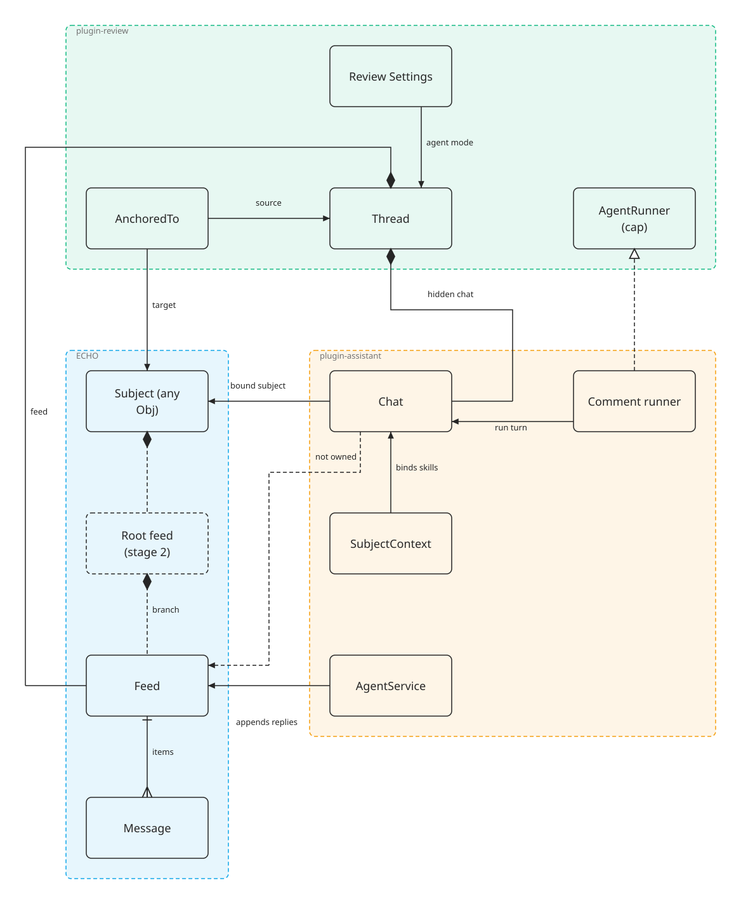

# Comment threads on feeds

Status: stage 1 IMPLEMENTED; stages 2 and 3 are direction, not yet designed in detail.

## Problem

The comment agent only understands Markdown. A comment on a diagram gets the reply "my tools only
let me edit the markdown document", because plugin-review runs its own one-shot LLM call
(`src/capabilities/agent-runner.ts`) with a Markdown prompt, two text-edit tools, and no context
for any other subject type. It also imports `@dxos/plugin-markdown`, which `PLUGIN.mdl` F-7.1
forbids.

The assistant already does everything the comment agent needs: it binds a subject to a `Chat`, pulls
in that type's skills through `SubjectContext`, and runs turns through `AgentService`. The two
should share one conversation model instead of keeping two.

## Common denominator

Review and chat share the **feed of `Message`s**, not the `Chat`. Each conversation container is a
thin object that owns (or points at) a feed and adds only what its role needs.

| Container           | Adds to the feed                                      | Owner of the AI turn                                       |
| ------------------- | ----------------------------------------------------- | ---------------------------------------------------------- |
| `Thread` (comments) | subject anchor (`AnchoredTo`), `status`, `agent` mode | plugin-assistant, via `AppCapabilities.CommentAgentRunner` |
| `Channel`           | `backend` (local feed, email, Bluesky, …)             | plugin-agent relays                                        |
| `Chat`              | `session` (model), `instructions`, `tasks`, `remote`  | `AgentService`                                             |

`Thread` and `Chat` stay separate types: merging them would put model and task fields on every
comment, and anchors on every chat.

## Types

- **Subject** — any ECHO object that can be commented on (`AppCapabilities.CommentConfig`).
- **AnchoredTo** — relation from a `Thread` to its subject, with an optional cursor range.
- **Thread** — owns its `Feed` (replaces `messages: Ref<Message>[]`); owns a hidden `Chat` when the
  agent is on.
- **Feed / Message** — the shared store; one feed per thread in stage 1.
- **Chat** — the hidden per-thread chat; points at the thread's feed without owning it, and is bound
  to the subject.
- **SubjectContext** — the assistant's per-type contributions that bind skills (the drawing skill for
  a diagram, the Markdown skill for a document).
- **CommentAgentRunner** — capability in `@dxos/app-toolkit`, contributed by plugin-assistant; neither
  plugin depends on the other.
- **Review Settings** — `commentAgentMode` (`off` | `auto` | `mention`, default `mention`) decides
  which threads get the agent and when it answers.
- **Root feed** (stage 2, dashed) — one per subject; thread and chat feeds become its branches.

## Stage 1 — threads on feeds, assistant runs the turns

1. **`Thread` 0.3.0 owns a `Feed`.**
   - `messages` is replaced by `feed: Ref<Feed>` with `SetParent`, so deleting a thread deletes its
     feed. `Thread.make` creates the feed, and adding the thread to a database adds it too.
   - `Thread.messagesQuery`, `Thread.sortMessages` and `Thread.loadMessages` read it. Messages are
     ordered by `created`, not by feed position, because an edit or re-append takes a new position.
   - The `threadMessagesToFeed` migration (plugin-review) moves 0.2.0 threads' messages into a new
     feed, keeping each message's id.
2. **Operations write to the feed.**
   - `AddMessage` saves a staged thread first, then calls `Feed.append`. A comment carries
     `role: 'user'`, which the agent reads it as.
   - `DeleteMessage` calls `Feed.remove`; `RestoreMessage` re-appends the message under its own id
     and `created`, so the send-order sort puts it back in place (`src/thread-feed.test.ts`).
3. **Readers query the feed.** The comments companion (`useThreadMessages`), plugin-thread's
   `ThreadArticle` and the debug snapshot read the feed. The companion shows only messages with a
   visible block, which hides the agent's synthetic prompts, reasoning and tool traffic.
4. **`Chat.feed` may be unowned.** `SetParent.set({ override: false })`: a chat claims a feed only
   when nothing else owns it, so a thread keeps its feed while a chat runs on it.
5. **plugin-assistant runs the turns.**
   - `AddMessage` schedules `RespondToThread` when `shouldTriggerAgent` passes and a runner is
     contributed.
   - The runner finds or creates the thread's chat with `CreateChat { feed }`, parented to the thread
     so the Chats section (which skips parented chats) never lists it, binds the subject with
     `BindChatContext`, and runs `RunPromptInChat` with a synthetic prompt naming the object and the
     anchored text (`AppCapabilities.AnchorResolver`).
   - plugin-review's own runner, its Markdown prompt and its two text-edit tools are deleted.

## Stage 2 — one root feed per subject

Each subject gets a root feed it owns. Comment-thread feeds and companion-chat feeds become branches
under it, so "ask the assistant about this" can fork a branch from any message. Item-level forks
already exist inside a feed (`Feed.PARENT_KEY`, `Feed.history`); this stage adds the object-level
structure and a merged view across branches.

## Stage 3 — channels on the same model

plugin-agent's relay mirrors a channel thread into a `Chat` and copies messages
(`AgentChannels.conversationOf`). With unowned chat feeds it can run turns on the channel's feed
directly.

## Open items

1. Whether the Markdown skill can replace an anchored range; the deleted `editAnchoredRange` tool has
   no equivalent there yet.
2. Cost of one feed and one agent session per thread in a busy document.
3. Tool calls and permission requests are hidden in the comment UI; a turn that waits on a permission
   request shows nothing until it is answered elsewhere.
