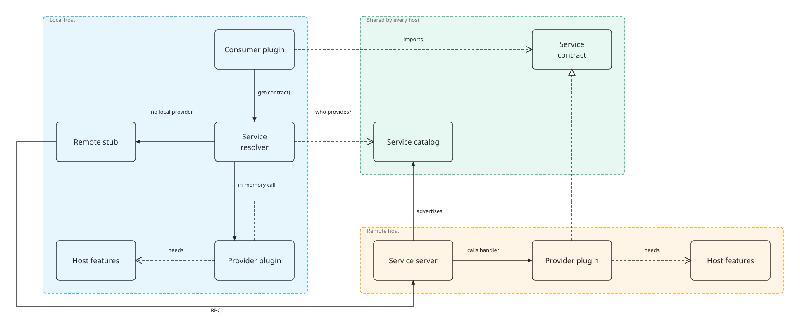
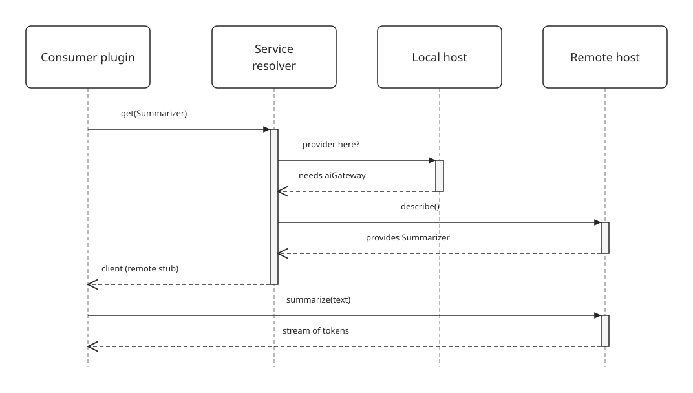
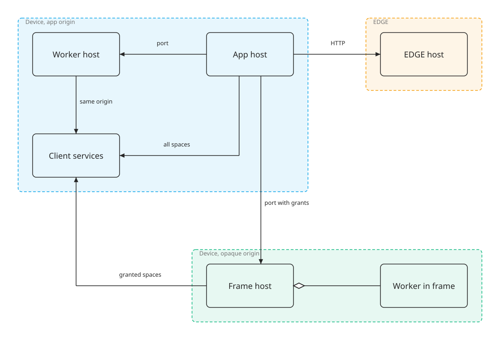

# Plugin services: one mechanism for capabilities, layer specs and remote plugins

Status: proposal, with a working spike. The spike is this package (`packages/stories/stories-services`);
its answers are in [Spike results](#spike-results). Nothing else here is built.

## Overview


<details>
<summary>Diagram source</summary>

```diagram
diagram flow=right
node Consumer "Consumer plugin"
node Service "Service" right-of Consumer
node Provider "Provider plugin" right-of Service
edge Consumer -> Service "calls"
edge Provider implements Service "provides"
```

</details>

- **Service.** A named interface: methods, properties and events, each with a schema. It is the
  only thing the two plugins share.
- **Provider plugin.** Implements the service. It can run in the app, in a worker or frame, or on
  EDGE.
- **Consumer plugin.** Calls the service. It does not know which plugin provides it or where that
  plugin runs.

The same three roles, with every place a provider plugin can run:


<details>
<summary>Diagram source</summary>

```diagram
diagram flow=right
group app "App host: main thread" {
  node Consumer "Consumer plugin"
  node Resolver "Service resolver" ref="packages/core/compute/compute/src/ServiceResolver.ts"
  node ProviderApp "Provider (app)"
}
node Contract "Service contract"
node Catalog "Service catalog" ref="packages/core/protocols/src/PluginProtocol.ts"
group isolated "Isolated on the device" {
  node ProviderWorker "Provider (worker)" ref="packages/sdk/worker-framework/src/Worker.ts"
  node ProviderFrame "Provider (frame)" ref="packages/plugins/plugin-cloudflare-os/src/api/Sandbox.ts"
}
group remote "EDGE" {
  node Router "Router"
  node ProviderEdge "Provider (EDGE)" ref="packages/core/compute/plugin-host-cloudflare/src/PluginHost.ts"
}
edge Consumer -> Resolver "get(contract)"
edge Resolver -> ProviderApp "in memory"
edge Resolver -> ProviderWorker "port"
edge Resolver -> ProviderFrame "port + grant"
edge Resolver -> Router "HTTP"
edge Router -> ProviderEdge "Workers RPC"
edge Resolver depends-on Catalog "who provides?"
edge ProviderApp implements Contract "implements"
edge ProviderWorker implements Contract "implements"
edge ProviderFrame implements Contract "implements"
edge ProviderEdge implements Contract "implements"
```

</details>

- **One contract, four placements.** The provider plugin is the same bundle in each. What differs
  is the host it runs in and the binding the resolver uses to reach it.
- **The resolver chooses.** It asks the catalog which hosts provide the contract, drops the ones
  that lack a feature the provider needs or that the plugin's isolation policy forbids, and
  prefers the nearest.
- **The consumer's code does not change.** It holds one client whichever provider answers.


## Summary

A plugin provides **services**. A service has a **contract**: a key, a version, and schemas for its
methods, properties and events. A consumer asks for a contract and gets a typed client. When a
provider runs in the same runtime the client calls it in memory. When it runs elsewhere (a Web
Worker, EDGE) the client is a stub that sends the same call over Effect RPC. The consumer's code is
the same in both cases.

Each runtime runs a **host** that loads plugins, activates their providers and serves their
contracts. A provider states the host features it needs (`localStorage`, `aiGateway`), and a resolver
picks the nearest host that has them.

The service replaces three things: layer specs, the JSON proxies EDGE serves to plugin bundles, and
stateful singleton capabilities. Operations stay as the verb a person or an agent invokes; their
handlers require services. Multi capabilities (surfaces, schemas, translations) stay as they are.

The client's own services (`DataService`, `SpacesService` and 16 more) already work this way: each is
an Effect RPC group registered on a router that serves it in process and over a port. This design
opens that pattern to plugins and adds what a plugin needs on top: a catalog, a space scope, host
features and resolution across hosts.

## Decisions taken

Rich accepted these defaults on 2026-11-25. Everything else in this document is a proposal.

| Id  | Decision                                                                                                                                                                  |
| --- | ------------------------------------------------------------------------------------------------------------------------------------------------------------------------- |
| U-1 | The service replaces layer specs, the JSON host-service proxies and stateful singleton capabilities. Multi capabilities stay.                                             |
| U-2 | An operation is a separate concept from a service. Its handler requires services.                                                                                         |
| U-3 | The JavaBeans precedent means a self-describing descriptor (methods, properties, events), a container-managed lifecycle, and local and remote interfaces.                 |
| U-4 | A service declares the host features it needs. The resolver picks the nearest runtime that has them and prefers local.                                                    |
| U-5 | Services are stateless over ECHO for now. A durable per-space instance is a later phase.                                                                                  |
| U-6 | EDGE-PLUGINS decisions D-41 and D-88 are reversed: plugins on EDGE call each other's services. Each plugin keeps its own isolate.                                         |
| U-7 | Install stays two lists: the space's plugin map and the device's enabled set. The local host also reads the space's map.                                                  |
| U-8 | The work is a registered project, `plugin-services`.                                                                                                                      |
| U-9 | The design must allow plugin services to be isolated in the client too, possibly through workers or iframes.                                                              |

## Review: what exists

Five mechanisms let one piece of code offer something to another. They were built at different
times and each solves part of the problem.

| Mechanism           | Defined in                                                                                       | Keyed by                | Carries                                          | Scope                       | Crosses a wire                    |
| ------------------- | ------------------------------------------------------------------------------------------------ | ----------------------- | ------------------------------------------------ | --------------------------- | --------------------------------- |
| Capability          | `packages/sdk/app-framework/src/core/capability.ts`                                              | NSID string             | Any JS value: object, atom, component, layer     | Application                 | No                                |
| Layer spec          | `packages/core/compute/compute/src/LayerSpec.ts`                                                 | Effect tag key          | An Effect layer with `requires` and `provides`   | Application, space, process | No                                |
| Client service      | `packages/core/protocols/src/*Service.ts`, `packages/core/mesh/rpc/src/RpcRouter.ts`             | RPC tag prefix          | An Effect `RpcGroup` and its handlers            | Application                 | Yes, typed; in process when local |
| Operation           | `packages/core/compute/compute/src/Operation.ts`                                                 | DXN                     | One handler with input and output schemas        | A process per invocation    | Yes, by per-call `on: 'edge'`     |
| EDGE host service   | `packages/core/protocols/src/PluginProtocol.ts`, `plugin-host-cloudflare/src/HostServices.ts`    | Effect tag key (string) | A proxy whose methods are JSON calls             | One invocation              | Yes, untyped                      |

### Capabilities

Plugins and sdk packages define about 279 capabilities: 111 multi and 168 singleton.

- **Multi capabilities are contributions.** Surfaces, schemas, translations, operation handlers and
  skills are stateless code or data that a host collects. They are imported on demand from a
  manifest that already lists each module's `requires`, `provides` and `environments`
  (`plugin-manifest.ts`).
- **Singleton capabilities are shared objects.** 64 hold a writable atom (settings and view state),
  5 hold a read-only atom, and the rest are managers and clients with an in-memory API.
- **They are application-scoped and in-memory.** A capability has no schema, so it cannot cross an
  isolation boundary, and it has no notion of a space.

### Layer specs

A layer spec is the closest existing thing to a service.

- **It is already a service registry.** A spec lists the Effect tags it requires and provides, and
  has an affinity of `application`, `space` or `process`. `LayerStack` builds each spec lazily per
  space or process, and `ServiceResolver.resolve(tag, { identity, space, conversation, process })`
  hands the result to operation handlers.
- **Plugins contribute specs through a capability.** `Capabilities.LayerSpec` is a multi capability,
  so layer specs ride the module and manifest machinery with no loader of their own.
- **It has no wire form.** A tag's service type is a TypeScript interface. Across packages there are
  about 200 `affinity` declarations (149 application, 34 space, 14 process), tests included.

### Client services

The client's own services are the one place where the target pattern is already built.

- **Each service is an RPC group.** `@dxos/protocols/rpc` defines 18 of them (`DataService`,
  `QueryService`, `SpacesService`, ...) as Effect `RpcGroup`s.
- **A layer spec registers each group on a router.** `RegisterService` in
  `packages/sdk/client-protocol/src/service-rpc.ts` adds a provider's handlers to the stack's
  `RpcRouter`. `LayerSpec.eager` exists for this case.
- **The router serves in process and over a transport.** `RpcRouter` serves every registered group
  over each attached transport (a `MessagePort` to the shared worker, an `RpcPort` to an iframe). Its
  in-process client calls the handlers directly, with no transport and no codec.
- **It is closed to plugins.** The set is fixed by the client. A group has no catalog entry, no
  space scope and no statement of what its host must provide.

### Operations and processes

- **Operations have schemas and are routed.** `ProcessOperationInvoker` spawns a process per
  invocation. With `on: 'edge'` it sends the encoded input to EDGE through `RemoteOperationInvoker`.
- **Placement is manual.** The caller names `local` or `edge` per call (`InvokeOptions.on`,
  `Process.Location`), and a call that names neither runs locally. Nothing derives placement from
  what the handler needs.
- **Not every operation is serializable.** `Operation.serializable()` silently drops operations
  whose schemas do not render as JSON Schema.
- **A durable process has one RPC group for two locations.** A local process serves its control
  group through a loopback (`RpcTest.makeClient` in `ProcessManager.ts`); a process on EDGE serves
  the same group over HTTP (`EdgeProcessControl.makeRpcClient`). The loopback is untyped: the group
  is `RpcGroup<any>` and the client is cast.

### Plugins on EDGE

`packages/sdk/app-framework/docs/EDGE-PLUGINS.mdl` records 92 decisions. The parts that matter here:

- **One bundle runs everywhere.** A module's `environments` decides at load whether it runs in the
  browser, Node, Tauri or `workerd` (D-23). About 236 module declarations set it.
- **EDGE runs plugin bundles.** compute-service's plugin router loads a published bundle into a
  Worker Loader isolate and calls `PluginProtocol.Entrypoint.invoke`. `OPERATION_ROUTING` still
  defaults to operation-service, with plugins moved over in batches (`dxos/edge` `origin/main`,
  `compute-service/src/plugins/plugin-router.ts`).
- **A bundle has no layer stack.** `PluginActivation.ts` collects a plugin's operation handlers,
  schemas, skills, hooks and toolkits. It does not read layer specs, although the spec's "Module
  body and host" section lists them. A handler's services are set per invocation with
  `Effect.provideService` (`HostServices.ts`).
- **Host services are an untyped RPC.** EDGE serves nine services to a bundle through
  `ServiceHost.call(service, method, args)` with JSON arguments. The bundle rebuilds each one with a
  `Proxy`, and EDGE validates arguments by hand (`invocation-scope.ts` has `stringArg`, `isWake`,
  `isSendRequest`). plugin-agent's `HostServiceAdapter` re-hydrates one of them.
- **A plugin runs alone.** A bundle shares no capabilities with other plugins (D-41), and reading
  another plugin's contributions is out of scope (D-88). Hooks do not reach an agent turn on EDGE
  for this reason.
- **Durable processes are a closed set.** compute-service compiles its process registry in; a
  plugin cannot contribute one (D-80).

### Isolation in the client

Every plugin runs in the app's main thread today, with the app's memory and storage. Three pieces
of an isolated client host exist, none of them connected to plugins.

- **A worker with dynamic modules.** `@dxos/worker-framework` elects a leader tab that hosts one
  dedicated worker, connects other tabs to it by exchanging `MessagePort`s, and carries Effect RPC
  over them. Its `ModuleHost` story imports modules by URL into the worker and calls them through
  an untyped `invoke(module, method)`.
- **A sandboxed frame.** plugin-cloudflare-os runs a gadget's UI in a null-origin iframe
  (`sandbox="allow-scripts ..."`) with `connect-src 'none'`; `postMessage` is its only way out
  (`GadgetFrame.tsx`, `api/Sandbox.ts`).
- **A sandbox interface with three placements.** agent-code-mode's `Sandbox` runs code in process,
  on a worker thread or in a `workerd` isolate. Its own comment says the in-process form is not a
  security boundary and that only a worker can be terminated.

### Findings

1. **There are four registries of "a thing provided under a key".** Capability tags, layer-spec
   tags, operation keys and RPC routes each have their own lookup and lifecycle.
2. **The remote service mechanism on EDGE has no contract.** `ServiceHost.call` is the
   serializable RPC this proposal asks for, minus schemas, streams with back-pressure, and types
   shared by both ends.
3. **The transparent local-or-remote call exists, but not for plugins.** Client services and
   durable processes each serve one `RpcGroup` in process and over a wire. Nothing a plugin
   provides can use either.
4. **Placement is declared in three ways.** A module's `environments`, a call's `on`, and
   compute-service's routing variables each decide where code runs.
5. **Isolation on the client is undecided.** `.agents/projects/mcp/DESIGN.md` §2.6 leaves
   third-party plugin isolation in the browser open. A wire contract is the precondition, and the
   worker, the sandboxed frame and the port transport it needs are already in the repo.
6. **Cross-plugin behaviour on EDGE has no path.** D-88 defers it because capabilities are
   in-memory objects.

## Approaches

Four ways to get one mechanism. The third is the proposal.

1. **Give capabilities schemas.** Add an optional schema to a capability tag and proxy it over RPC.
   Most of the 279 definitions hold values that cannot be serialized (components, atoms, live
   clients), the capability manager has no space scope, and multi capabilities would gain a wire
   form they do not need.
2. **Make operations the only remote call.** Model a service as a set of operations. Every call
   would spawn a process and appear in history, undo and the agent's tool catalog. Operations have
   no streams and no properties.
3. **Promote the layer spec to a service with a contract.** Chosen. A layer spec already has the
   lifecycle, the `requires` and `provides` graph, the space scope and the capability that carries
   it in a manifest. Client services already pair a layer spec with an RPC group on a router, which
   is this design applied to one fixed set. EDGE's host-service proxies satisfy the same tags by
   key. The missing parts are a contract a plugin can declare, host features, a catalog entry and
   a resolver that binds across hosts.
4. **Adopt an external component model.** Cap'n Web or Workers RPC everywhere, or the WASM
   component model. Each either has no browser story or discards the Effect layers every handler
   is written against.

## Design

### Vocabulary

| Term         | Meaning                                                                                  | JavaBeans and EJB counterpart                |
| ------------ | ---------------------------------------------------------------------------------------- | -------------------------------------------- |
| Contract     | A key, a version, and schemas for methods, properties and events.                        | The bean's interface and its `BeanInfo`      |
| Provider     | A plugin module that implements a contract.                                              | The bean                                     |
| Client       | The typed value a consumer holds.                                                        | A local reference or a remote stub           |
| Host         | The runtime's container: loads plugins, activates providers, serves contracts.           | The container, `BeanContext`                 |
| Host feature | Something only a runtime has, such as `localStorage` or `aiGateway`.                     | A container-provided resource                |
| Catalog      | The contracts a host or a published plugin provides, as JSON.                            | The deployment descriptor                    |
| Affinity     | The provider's lifetime: `application`, `space` or `process`.                            | Stateless and stateful session scopes        |
| Kind         | `remote` (has schemas, may cross a wire) or `local` (in-memory only).                    | Remote and local interfaces                  |



<details>
<summary>Diagram source</summary>

```diagram
diagram flow=down
group local "Local host" {
  node Consumer "Consumer plugin"
  node Resolver "Service resolver" ref="packages/core/compute/compute/src/ServiceResolver.ts"
  node LocalPlugin "Provider plugin"
  node Stub "Remote stub"
  node LocalFeatures "Host features"
}
group shared "Shared by every host" {
  node Contract "Service contract"
  node Catalog "Service catalog" ref="packages/core/protocols/src/PluginProtocol.ts"
}
group remote "Remote host" {
  node Server "Service server" ref="packages/core/mesh/rpc/src/RpcRouter.ts"
  node RemotePlugin "Provider plugin"
  node RemoteFeatures "Host features"
}
edge Consumer -> Resolver "get(contract)"
edge Consumer depends-on Contract "imports"
edge Resolver -> LocalPlugin "in-memory call"
edge Resolver -> Stub "no local provider"
edge Stub -> Server "RPC"
edge Server -> RemotePlugin "calls handler"
edge LocalPlugin depends-on LocalFeatures "needs"
edge RemotePlugin depends-on RemoteFeatures "needs"
edge LocalPlugin implements Contract
edge RemotePlugin implements Contract
edge Resolver depends-on Catalog "who provides?"
edge Server -> Catalog "advertises"
```

</details>

The consumer plugin and both provider plugins import the same contract and nothing else from each
other. A provider plugin is the same bundle in either host; its host's features decide where its
provider can activate.

### How the design uses Effect

Effect is the design's type system for services. The sections below rely on it in five ways.

1. **A contract is schemas plus an RPC group.** Each method, property and event carries an Effect
   `Schema`. The contract compiles them into one Effect `RpcGroup`, which is its only wire form.
2. **A client is made of `Effect` and `Stream` values.** A method returns an `Effect`, a streaming
   method a `Stream`, a property is `{ get: Effect, changes: Stream }`, and an event is a `Stream`.
   Failures are in the typed error channel, so a consumer recovers by tag. A provider is written
   as the same type, which is what lets the in-memory binding hand the consumer the provider's own
   object.
3. **A contract is a service tag, and a provider is a layer.** A handler writes `yield* Summarizer`
   and an operation lists the contract in `services`, as both do for a layer-spec tag today. The
   provider supplies a `Layer` of handlers whose requirements are other services.
4. **A lifetime is a `Scope`.** A provider is built into the scope of its affinity; closing the
   scope ends its streams and removes it from the router. A connection to another host has a scope
   of its own, so disconnecting closes its clients and servers together.
5. **The transport is Effect RPC on the existing router.** A provider registers its group on
   `RpcRouter`, which already serves the client's own services. The design adds two protocols under
   the same server and client: HTTP and Workers RPC.

The host itself should also be Effect: layers for its parts and fibers for its work, so that
interruption and resource safety come from the runtime. The spike's host is not; see
[Where the spike differs from the design](#where-the-spike-differs-from-the-design).

### Contract

A contract is data plus schemas. It imports no implementation, so a consumer depends on the
contract's package and never on the provider's. The types below are a sketch for the spike to
confirm, not final signatures.

```ts
// packages/plugins/plugin-summarizer/src/types/Summarizer.ts
import * as Schema from 'effect/Schema';

import * as Service from '@dxos/compute/Service';

export const Summarizer = Service.make('org.dxos.plugin.summarizer.service.summarizer', {
  version: '0.1.0',
  methods: {
    summarize: {
      payload: Schema.Struct({ text: Schema.String }),
      success: Schema.String,
      stream: true,
    },
    cancel: { payload: Schema.Struct({ id: Schema.String }), success: Schema.Void },
  },
  properties: {
    status: Schema.Literals(['idle', 'busy']),
  },
  events: {
    completed: Schema.Struct({ id: Schema.String, tokens: Schema.Number }),
  },
});
```

```ts
// @dxos/compute/Service
export interface Contract<Key extends string, Shape extends ContractShape> {
  readonly key: Key;
  readonly version: string;
  readonly kind: 'remote' | 'local';
  readonly methods: Shape['methods'];
  readonly properties: Shape['properties'];
  readonly events: Shape['events'];
  /** The Effect RPC group the three maps compile to; the only wire form. */
  readonly rpcs: RpcGroup.RpcGroup<RpcsOf<Shape>>;
}

/** What a consumer holds. Identical for the in-memory and the remote binding. */
export type Client<C extends Contract.Any> = {
  readonly [M in keyof C['methods']]: MethodOf<C['methods'][M]>; // Effect, or Stream when `stream`
} & {
  readonly [P in keyof C['properties']]: Property<Schema.Schema.Type<C['properties'][P]>>;
} & {
  readonly [E in keyof C['events']]: Stream.Stream<Schema.Schema.Type<C['events'][E]>, ServiceError>;
};

export interface Property<A> {
  readonly get: Effect.Effect<A, ServiceError>;
  readonly changes: Stream.Stream<A, ServiceError>;
  /** For React: the provider's own atom in memory, a mirror fed by `changes` over a wire. */
  readonly atom: Atom.Atom<Result.Result<A, ServiceError>>;
}
```

- **A contract is an Effect service tag.** Its service type is `Client<C>`. An operation lists it in
  `services: [Summarizer]` and a handler writes `yield* Summarizer`, as it does for a layer-spec tag
  today.
- **Properties and events compile to RPCs.** A property `status` becomes `$get.status` and a stream
  `$watch.status`; a writable property adds `$set.status`; an event `completed` becomes a stream
  `$on.completed`. One `RpcGroup` per contract is the whole wire.
- **Identity is the key string.** Each EDGE isolate vendors its own copy of every package, so two
  copies of one contract module must be equal by `key` and `version`, never by object identity.
- **A migrated tag keeps its key.** Operation records persist their services as tag key strings
  (`Operation.serialize`), so a layer-spec tag that becomes a contract keeps the key it has. Only
  new contracts take an NSID.
- **Versions follow semver.** A provider satisfies a consumer when it has the same major version
  and an equal or higher minor. Adding a method, property or event is a minor change; anything else
  is a major one. A mismatch fails with `ServiceVersionError`.
- **An existing RPC group is already a contract.** `Service.fromRpcGroup(key, group)` wraps a client
  service group without changing it, so the 18 client services need no migration.
- **A local contract has no schemas.** `Service.local<ViewStateManager>()('org.dxos.plugin.deck.service.viewState')`
  is a typed key with the same lifecycle and resolver, which cannot cross a wire. This is what a
  singleton capability or a layer-spec tag becomes first.

### Provider

A provider is a layer spec with a contract and a list of host features. It is what a client service
does today with `LayerSpec.make` and `RegisterService`, written as one declaration.

```ts
// packages/plugins/plugin-summarizer/src/capabilities/summarizer.ts
export default Capability.makeModule(() =>
  Effect.succeed(
    Capability.contribute(
      Capabilities.Service,
      Service.provide(Summarizer, {
        affinity: 'space',
        needs: [Host.aiGateway],
        requires: [AiService.AiService],
        make: () => SummarizerLive, // Layer<Service.Handlers<typeof Summarizer>, never, AiService>
      }),
    ),
  ),
);
```

- **Providers are contributed through one multi capability.** `Capabilities.Service` replaces
  `Capabilities.LayerSpec`, so the module loader, `requires` and `provides` ordering and lazy import
  are unchanged. `AppCapability.service(() => import(...))` replaces `AppCapability.layerSpec`.
- **The manifest lists a module's services.** Each manifest module gains
  `services: [{ key, version, kind, affinity, needs }]`, so a host knows what a plugin provides
  without importing a body.
- **A remote provider keeps no durable state of its own.** What must outlive the provider lives in
  ECHO or behind a host feature (U-5). Two providers of one remote contract are therefore
  interchangeable, which is what lets the resolver choose between hosts.
- **A provider may hold state for its scope.** A property's current value lives in the provider's
  memory for as long as its affinity's scope lasts. A local contract in the app host, such as view
  state, is ordinary in-memory state; U-5 does not constrain it because it never runs elsewhere.
- **Lifecycle is the host's.** A provider activates when its contract is first resolved, lives for
  its affinity's scope and is disposed when the scope closes or its plugin is disabled. `eager`
  keeps the layer-spec meaning.

### Client and bindings

`Service.get(contract, context?)` returns a client. Inside a process the context is the process's
own, as it is for `ServiceResolver` today.

| Binding     | When                                         | Transport                                                  | Exists today                                       |
| ----------- | -------------------------------------------- | ---------------------------------------------------------- | -------------------------------------------------- |
| In-memory   | The provider is active in this host.         | A direct call of the handler; no encoding.                 | `RpcRouter`'s in-process client                    |
| Port        | The provider is in a Worker, iframe or tab.  | Effect RPC over `MessagePort` or `RpcPort`.                | `RpcRouter.attach`, `effect-rpc.ts`                |
| HTTP        | The browser calls EDGE.                      | Effect RPC over HTTP, ndjson.                              | `EdgeProcessControl.makeRpcClient`                 |
| Workers RPC | An isolate calls EDGE or another isolate.    | A Workers RPC stub carrying encoded RPC messages.          | `ServiceHost.call` (untyped), `WorkerdBridge.ts`   |

- **The host's RPC server is `RpcRouter`.** A provider registers its contract's group on the
  host's router, as `RegisterService` does. The router serves it over every attached transport
  and gives the in-memory binding its client. Only the HTTP and Workers RPC transports are new.
- **A client is a stable handle that binds per call.** The handle a consumer holds does not
  change when the provider moves. Each call goes to the provider bound at that moment, and a call
  in flight finishes on the provider that took it. After a rebind, a property's `changes` emits
  the new provider's current value; values are not copied between providers.
- **Every call carries its context.** The resolution context (`identity`, `space`, `conversation`,
  `process`), the calling plugin's key and the contract version travel as RPC headers.
- **Strict mode keeps local development correct.** In tests and development the in-memory binding
  encodes and decodes every payload through the contract's schemas, so a value that would not
  survive a wire fails on the developer's machine.
- **ECHO objects cross as references.** A contract schema that takes an object encodes it as
  `{ '/': uri }`; the caller flushes, the callee loads. This is the rule EDGE-PLUGINS D-71 already
  set for nested operations.
- **Failures are typed.** `ServiceNotAvailableError` (no provider, with the unmet features),
  `ServiceVersionError` (the provider's version does not satisfy the consumer's), and the
  contract's own error schemas.



<details>
<summary>Diagram source</summary>

```diagram
diagram kind=sequence
node Consumer "Consumer plugin"
node Resolver "Service resolver"
node Local "Local host"
node Remote "Remote host"
edge Consumer calls Resolver "get(Summarizer)"
edge Resolver calls Local "provider here?"
edge Local returns Resolver "needs aiGateway"
edge Resolver calls Remote "describe()"
edge Remote returns Resolver "provides Summarizer"
edge Resolver returns Consumer "client (remote stub)"
edge Consumer calls Remote "summarize(text)"
edge Remote returns Consumer "stream of tokens"
```

</details>

### Hosts, features and placement

A host is the container for one runtime. It holds a plugin manager, a layer stack, an RPC router and
a set of features.

- **The app host owns the layer stack.** Today the process-manager plugin builds the `LayerStack`
  (`process-manager-capability.ts`), so nothing resolves a service without that plugin. The stack
  and the router move into app-framework's core and are created with the plugin manager. The
  process manager becomes a consumer of them.
- **An application-scoped local contract can be read synchronously.** Singleton capabilities are
  read that way today, and `useCapability` suspends until one is contributed. `useService(contract)`
  does the same: it suspends until the provider has activated and then returns the client. Space-
  and process-scoped contracts, and every remote one, resolve as an Effect.
- **The EDGE host gets a layer stack.** PluginHost builds application-scoped providers once per
  isolate. One isolate serves every space (EDGE-PLUGINS D-6), so it builds space- and
  process-scoped providers per invocation, from the invocation's scope, and closes them when the
  call returns.

| Host            | Runtime                                | Features (initial vocabulary)                                   |
| --------------- | -------------------------------------- | --------------------------------------------------------------- |
| App host        | Browser or Tauri main thread           | `dom`, `localStorage`, `opfs`, `microphone`                     |
| Worker host     | Web Worker at the app's origin         | `opfs`; no `dom`, no `localStorage`                             |
| Frame host      | Sandboxed iframe on its own origin     | None of its own; see "Isolation on the client"                  |
| CLI host        | Node (`dx`)                            | `filesystem`, `shell`                                           |
| EDGE host       | `workerd` isolate (PluginHost)         | `aiGateway`, `email`, `alwaysOn`; later `durableStorage`        |

Resolution of a contract in a context:

1. Collect the providers of the contract's key from plugins installed for the context: the device's
   enabled set, and the space's `properties.plugins` map.
2. Drop a provider whose version does not satisfy the consumer's.
3. Drop a provider whose `needs` its host does not have.
4. Drop a host the plugin's isolation policy does not allow.
5. Order the rest: this host, then other hosts on this device, then EDGE.
6. Bind the first. Its location decides the binding.
7. If none remain, fail with `ServiceNotAvailableError`.

Version is checked before distance, so a compatible provider on EDGE is chosen over an incompatible
one in the app. Among compatible providers the nearest still wins.

`needs` says where a provider can run. The isolation policy says where it may run, and the person
installing the plugin sets it, never the plugin.

`Service.get(contract, { on: 'edge' })` pins a host, which keeps today's manual override. A
module's `environments` stays for modules that provide no service. For a provider module it is
derived from `needs`.

### Isolation on the client

A plugin's services can run outside the app's main thread, in a worker or a frame, with the same
contract and the port binding (U-9). The two give different boundaries, so they are two hosts.



<details>
<summary>Diagram source</summary>

```diagram
diagram flow=down
group app "Device, app origin" {
  node ClientServices "Client services" ref="packages/sdk/client-protocol/src/service-rpc.ts"
  node AppHost "App host"
  node WorkerHost "Worker host" ref="packages/sdk/worker-framework/src/Worker.ts"
}
group sandbox "Device, opaque origin" {
  node FrameHost "Frame host" ref="packages/plugins/plugin-cloudflare-os/src/api/Sandbox.ts"
  node FrameWorker "Worker in frame"
}
group remote "EDGE" {
  node EdgeHost "EDGE host" ref="packages/core/compute/plugin-host-cloudflare/src/PluginHost.ts"
}
edge AppHost -> WorkerHost "port"
edge AppHost -> FrameHost "port with grants"
edge AppHost -> EdgeHost "HTTP"
edge AppHost -> ClientServices "all spaces"
edge WorkerHost -> ClientServices "same origin"
edge FrameHost -> ClientServices "granted spaces"
edge FrameHost owns FrameWorker
```

</details>

| Host        | Boundary                                    | Protects against                                               | For                                                |
| ----------- | ------------------------------------------- | -------------------------------------------------------------- | -------------------------------------------------- |
| Worker host | A thread at the app's origin                | A hang, a crash, work that blocks the main thread              | Trusted plugins with heavy or background services  |
| Frame host  | A sandboxed iframe on its own origin        | Code that reads the app's memory, storage or identity, or that sends data to another origin by a request (two paths stay open; see below) | Plugins the person does not trust     |
| EDGE host   | A `workerd` isolate with no outbound access | The same, on EDGE                                              | Providers that need EDGE's features                |

- **A worker alone is not a trust boundary.** A worker the app creates runs at the app's origin, so
  it can open the app's IndexedDB and OPFS, where ECHO and the identity's keys live. It isolates
  faults and CPU time. The host can terminate it, which nothing can do to code on the main thread.
- **A frame on its own origin is the trust boundary.** A frame served from an origin other than
  the app's has its own storage and cannot reach the app's. A frame host is hidden, and it may
  start a worker of its own, which shares the frame's origin and gives both boundaries.
- **A worker in the frame needs the policy too.** A worker does not inherit the policy of the
  document that started it; it takes its policy from its own script's response. A worker served
  without one could send granted data to any origin, whatever the frame's document says. The
  origin that serves a frame host must send the same policy with the worker's script, and phase
  3's isolation test has to probe the worker as well as the frame.
- **A content security policy limits what the frame can send out, but not all of it.** The frame's
  document is served with `default-src 'none'` and its own origin as the only script source. That
  refuses `fetch`, sockets, images and every other request except a script from the frame's own
  origin; `connect-src` alone would leave images open. Two paths stay open:
  - **A script request to the frame's own origin.** This is how the frame's code loads, so the
    policy has to allow it, and the request's URL can carry granted data to whoever serves that
    origin. It is safe only if the origin serves a published bundle and nothing the plugin's
    author controls.
  - **Navigating itself.** The frame can set its own address to any URL, which can carry granted
    data, and the policy does not govern it.

  An EDGE isolate has neither path, since `globalOutbound: null` removes all of it. Closing them on
  the client is not designed here.
- **An opaque origin does not work.** The first draft used `sandbox` without `allow-same-origin`,
  which gives the frame an opaque origin. The spike showed that such a frame cannot load module
  scripts: they are fetched with `Origin: null`, and the dev server does not answer that origin.
  A server could be made to answer `null`, but every opaque origin shares that value, so allowing
  it is the same as allowing any sandboxed page anywhere to load the bundle; it cannot serve as
  authorization. The design therefore gives a frame host a real second origin, such as one per
  plugin under a dedicated domain, with the bundle served to that origin. An opaque origin with a
  server that answers `null` remains possible where the bundle is public anyway.
- **An isolated host is given contracts, not features.** A frame host has none of the app's
  storage, and its policy refuses its requests to other origins, except the network hosts in its grant. What it is meant to use is the contracts
  the app host serves on its port: ECHO through the client service groups, limited to the spaces
  it was granted, and a key-value contract scoped to the plugin. This is the EDGE arrangement,
  where a bundle reaches everything through `env` bindings. Unlike an EDGE isolate, a frame keeps
  the two paths above, which the contracts do not cover.
- **A grant says what an isolated plugin may use.** A plugin's manifest lists the contracts it
  uses and the network hosts it calls. The person approves the list at install. The app host's
  router enforces it per port with RPC middleware, and writes the hosts into the frame's content
  security policy. compute-service can check the same list on EDGE. A peer with a grant cannot
  install into the host that granted it, and sees only the granted contracts in that host's catalog.
- **A worker or frame loads the bundle the way EDGE does.** Composer's import map supplies a
  plugin's external packages on the main thread. A worker does not read the page's import map, so
  a worker or frame host loads the plugin from its `vendor/` directory with the imports rewritten
  by `PluginLoader.rewriteImports` in `@dxos/edge-compute`. "One bundle for every runtime"
  (EDGE-PLUGINS D-23) then covers the client's hosts. The spike did not test this: its dev
  server rewrites imports itself, so the `vendor/` path was never exercised (see answer 7).
- **The app host supervises its child hosts.** It starts one when a contract first resolves
  there, restarts it after a crash, terminates it when a ping goes unanswered, and closes it when
  idle. `@dxos/worker-framework` already keeps one worker for all tabs, so an application-scoped
  provider in a worker host is one instance per browser profile, not one per tab.
- **Hosts are per trust domain, not per service.** Each isolated host loads its own copy of
  Effect, the ECHO client and the plugin host. One worker host serves every trusted background
  provider; each untrusted plugin gets one frame host.
- **A surface cannot cross the boundary.** A surface is a React component in the app's document.
  An isolated plugin's UI has to render in a visible sandboxed frame that a host-owned surface
  embeds, as `GadgetFrame` does. That is not part of this design. Until it exists, a plugin is
  isolated only when none of its modules runs in the app host.

### Catalog and install

- **The catalog lists services.** `PluginProtocol.Catalog` gains `services`: each contract's key,
  version, kind, affinity, needs and JSON Schema. registry-service indexes contract key to plugin,
  as it indexes operation keys today.
- **Install is itself a service.** Each host provides `org.dxos.host.service.plugins` with
  `install`, `uninstall` and `list`, and a property `installed`. The app host's provider wraps the
  plugin manager and the existing URL loader. The EDGE provider writes the space's
  `properties.plugins` map; the router loads a bundle on first use, so no deploy step exists.
- **The two lists stay (U-7).** The device's enabled set is unchanged. The app host also reads the
  space's map and offers to enable those plugins on the device.

### Operations and capabilities

- **Operations sit on top.** An operation's `services` may list contracts. Undo, history, skills
  and MCP exposure are unchanged.
- **An operation still runs where it is invoked.** A handler whose services resolve to stubs runs
  locally and calls out, so the default for every existing operation is unchanged. The invoker
  sends an operation to another host in three cases: the caller passes `on`; this host has no
  handler for the key; or the handler requires a local contract or a host feature that only
  another host has. The third case is what replaces a caller's guess.
- **Multi capabilities are unchanged.** They remain the mechanism for stateless code that a host
  imports on demand.

| Today                                         | Count           | Becomes                                                          |
| --------------------------------------------- | --------------- | ---------------------------------------------------------------- |
| Multi capability                              | 111             | Unchanged                                                        |
| Singleton capability holding a writable atom  | 64              | A writable property of a local contract                          |
| Singleton capability holding a read-only atom | 5               | A property of a local contract                                   |
| Other singleton capability                    | about 99        | A local contract; made remote when a second host needs it        |
| Layer spec                                    | about 200 sites | A provider of a local contract; made remote in the same way      |
| Client service RPC group                      | 18              | Unchanged; wrapped as a contract when another host needs it      |
| EDGE host service descriptor                  | 9               | A remote contract that compute-service provides                  |
| `HostServiceAdapter` capability               | 1 use           | Deleted; the contract's schemas do the decoding                  |

### What changes in EDGE-PLUGINS

Each of these is a new decision in the spec's changelog, written when its phase starts.

- **D-68 becomes typed.** `InvocationScope.services` carries a resolver stub keyed by contract. A
  bundle built with the new host has no descriptor list and no `Proxy`.
- **Protocol 2 stays served.** A published bundle is immutable and EDGE speaks each bundle's own
  protocol version (D-70). compute-service therefore keeps `ServiceHost.call` for version 2
  bundles until no channel points at one. Removing that path is its own task.
- **EDGE's contracts live with EDGE's protocol.** D-68 chose untyped calls so that compute-service
  would not import plugin-agent or plugin-discord. A contract is schemas with no implementation,
  so the nine contracts EDGE provides go in `@dxos/protocols`, beside `PluginProtocol` and the
  client service groups. One whose schemas need ECHO types goes in a private contract-only
  package. The plugins import them from there.
- **D-41 is narrowed.** A plugin still runs alone in its isolate. It can now call a contract that
  another plugin provides. compute-service is the router: it resolves the contract key to a
  bundle, as it resolves an operation key, and forwards the call. The isolate serves its own
  plugin's contracts through a new `PluginProtocol.Entrypoint` method.
- **D-88 is answered.** Behaviour crosses plugins as a service call. Data contributions (skills,
  schemas, hooks) cross as catalog entries the router already merges.
- **D-80 is unchanged for now.** Plugin-contributed durable processes and stateful services arrive
  with the Durable Object facet (D-8), in the last phase.

## Spike

A throwaway build that shows one app using a local and a remote plugin through the same API. It
answers the questions the design cannot settle on paper.

### What it shows

A private package `packages/stories/stories-services` with one Storybook story and one vitest file.

| Plugin              | Role                                                                                              | Host                                    |
| ------------------- | ------------------------------------------------------------------------------------------------- | --------------------------------------- |
| `notes`             | Provides `NoteStore` (`put`, `list`, property `count`, event `changed`); needs `localStorage`.    | App host, in memory                     |
| `summarizer`        | Provides `Summarizer` (streamed `summarize`, property `status`); needs `aiGateway`.               | Mock remote host: a Web Worker          |
| `panel`             | The consumer: contributes the notes and summarizer story modules, which call the two services.    | App host                                |

The story is laid out from story modules, as the stories in `stories-compute` and
`stories-assistant` are (`StoryModules` in `@dxos/storybook-testing`):

| Module             | Shows                                                                                         |
| ------------------ | --------------------------------------------------------------------------------------------- |
| `NotesModule`      | The notes, read and written through `NoteStore`.                                              |
| `SummarizerModule` | A summarize action and its streamed result, through `Summarizer`.                             |
| `HostsModule`      | Each host, the plugins installed in it, the install actions, where each contract is bound, and a log of each call with the binding that carried it. |

The first two are the consumer plugin's UI and call services only through their clients. The story
has these three modules; the shared logging module is not in its layout. The mock
EDGE host is a service container: a Web Worker that runs the same host code as the app, loads the
summarizer plugin and serves its contract over a port.

The story walks through five steps:

1. The panel lists notes through `NoteStore`. The binding label reads "in-memory".
2. Summarize fails with `ServiceNotAvailableError`, because nothing provides `Summarizer`.
3. "Install remotely" calls `install` on the worker host with the summarizer's manifest URL. The
   worker's catalog changes, the resolver binds a stub, and tokens stream into the panel. The
   label reads "port".
4. "Install locally with a fake gateway" enables the same plugin in the app host. The resolver
   rebinds in memory with no change to the panel.
5. "Install in a frame" loads the same plugin in a hidden sandboxed iframe with `connect-src
   'none'`. The summarizer still streams over a port. A probe method in the plugin then tries to
   read the app's `localStorage` and IndexedDB and to `fetch` a URL, and the panel shows all three
   refused.

An operation `notes.summarize`, whose handler requires both contracts, runs in step 3 to show
operations on top of services.

### What is mocked

- The remote host is a Web Worker running the same host code, reached over a `MessagePort`. It
  stands in for EDGE, and it is also the real worker host of "Isolation on the client".
- `aiGateway` is a canned token stream.
- There is no EDGE, no auth, no registry and no grant prompt: the manifest is a local URL and the
  frame is granted the one contract it provides.

### Questions it answers

1. Do the in-memory and port bindings give one `Client<C>` type with no cast? The durable-process
   loopback casts today, so this is not yet shown.
2. What does an in-memory call cost against a direct function call?
3. Do properties and events as stream RPCs feed an atom that React reads without tearing?
4. Does the space in the resolution context reach a provider in another host?
5. Can a host install a plugin from a manifest at run time and tell connected hosts?
6. Do contract types survive declaration emit across packages?
7. Does a worker load a plugin bundle through the `vendor/` rewrite alone, with no import map?
8. Does a sandboxed frame serve a contract over a port while the app's storage, and requests to
   the network, stay out of its reach?
9. What does one more host cost in memory and in time to first call?

The vitest file runs the same plugins with two in-process hosts joined by a `MessageChannel`, so
steps 1 to 4 are checked without a browser. Step 5 needs a browser test. Size: one session and one
draft PR that is not merged.

## Spike results

The spike is built and runs. `src/services/hosts.test.ts` has 19 passing tests with hosts joined by a
`MessageChannel` in Node, and the story `stories/stories-services/Services` was walked through all
five steps in a browser. Its `Calls` variant drives steps 1 to 4 with a play function, which the
Storybook test runner passes.

### What was observed

| Step | Observed in the browser                                                                                             |
| ---- | ------------------------------------------------------------------------------------------------------------------- |
| 1    | `NoteStore: memory → app`; a note is added and the count property updates.                                          |
| 2    | Summarize fails with `ServiceNotAvailableError` naming the contract.                                                |
| 3    | A worker starts as the mock EDGE host. Installing the summarizer there is a call on the worker's own contract. The binding becomes `port → edge` and the output begins `[edge]`. |
| 4    | With a gateway and the plugin in the app, the binding becomes `memory → app` and the output begins `[app]`. The panel's client was not rebuilt. |
| 5    | A frame on a second origin starts. The summarizer installs there, the binding becomes `port → frame` and the output begins `[frame]`. |

The probe, run in each child host:

| Host   | App's local storage | App's IndexedDB     | `fetch` | Image request | App's notes, not granted |
| ------ | ------------------- | ------------------- | ------- | ------------- | ------------------------ |
| Worker | Absent in a worker  | Sees the app's data | Allowed | No document   | Allowed                  |
| Frame  | Isolated            | Isolated            | Refused | Refused       | Refused                  |

This is the claim of "Isolation on the client" measured: the worker reads the app's IndexedDB, and
the frame reaches none of the five. The probe does not try the two paths the frame's policy leaves
open: a script request to its own origin, and navigating itself.

### Answers

1. **One client type for both bindings: yes for consumers, with casts inside the library.** A
   provider is written as a `Client<S>` and a consumer holds a `Client<S>`; the plugins, the
   modules and the test compile with no cast. The library has ten, all in `Service.ts` and
   `ServiceHost.ts`: it builds a client member by member from a contract's shape, and reads a
   provider the same way, so each member is narrowed by hand. Rpc tags are known only at run time,
   which is why the types cannot carry it. The in-memory binding does not use the rpc machinery at
   all: the consumer calls the provider's own object.
2. **In-memory cost: about 7 µs a call, against 75 µs over a port.** One timing of 5,000 calls in
   Node, not a benchmark: a bare Effect took 0.08 µs, a property read through the in-memory client
   7 µs, and the same read over a `MessageChannel` 75 µs. Most of the 7 µs is the spike's own
   per-call log and snapshot, not the binding.
3. **Properties and events as stream rpcs: yes.** A property's `changes` stream drives a React
   `useState` through one hook, and a test shows the stream following the provider across a
   rebind: it restarts from the new provider's value, as the design says.
4. **The space in the resolution context: not tested.** The spike carries no context in its calls.
5. **Install at run time, seen by connected hosts: yes.** `install` is a method of the contract
   every host provides. A host's catalog is a property of the same contract, so a peer's resolver
   learns of a new provider through the property stream it already watches.
6. **Contract types across packages: not tested.** The spike is one package.
7. **Loading in a worker without an import map: not answered.** Storybook's dev server rewrites
   bare imports, so the worker and the frame loaded plugins by URL with no import map and no
   `vendor/` rewrite. The built form, where the import map matters, was not run.
8. **A sandboxed frame serving a contract, out of reach of the app's storage and with `fetch` and
   image requests refused: yes, on a second origin.** See the probe table. The frame is served
   from the same dev server under the other loopback name. The probe tries `fetch` and an image
   request. It does not try a script request to the frame's own origin, which the policy allows,
   or the frame navigating itself, which the policy does not govern, so this is not a claim that
   the frame has no way to send data out.
9. **Cost of one more host: about 0.2 s to start, memory not measured.** One warm run: 205 ms
   from starting the worker to its catalog arriving, 233 ms for the frame, and about 30 ms to
   install a plugin in either. Each host loaded its own copy of Effect and app-framework.

### What the spike changed in the design

- **A frame host needs a real origin**, not an opaque one. The section above is corrected.
- **A plugin is loaded from the host's own origin.** Installing by an absolute URL of the app's
  origin failed in the frame, which may import only from where it was served. The failure reached
  the app as a typed error over the control contract.
- **A grant has to cover the catalog and the host's own contract, not only the services.** At
  first the frame was served no contract it was not granted, but it could read that the app
  provides notes, and it could call `install` on the app, which loads code in the app's realm. A
  peer with a grant now gets a catalog of what it was granted and is refused `install`.
- **A host must not answer a peer's catalog with its own.** The first version republished its
  catalog whenever a peer's arrived, so two idle hosts exchanged catalogs without end. A host now
  publishes its catalog only when it changes.
- **A hidden frame's timers may be throttled.** One run of the summarizer in the frame took 8.6 s
  for a stream that takes 0.3 s; a second run took 0.3 s. The cause was not found. If it is the
  browser throttling a hidden frame, a frame host has to run its providers in a worker.

### Where the spike differs from the design

- Each host has its own plugin manager, including the app host. In the design the app host is the
  app's plugin manager, and the consumer plugin and the provider plugins share it.
- There is no layer stack, no affinity and no space: a provider is built once per host.
- A provider's `make` returns an `Effect` of the implementation in a `Scope`, not a `Layer`, so a
  provider cannot require another service.
- The host is an imperative class with a promise queue that runs Effects at its edges. Several
  defects the review found (a timer left running, a swallowed failure, a scope left open) came
  from that bookkeeping, which layers and fibers would have made unnecessary.
- There is no `RpcRouter` in-process client and no strict mode. Each peer gets its own router,
  which is how a grant is enforced.
- Versions are compared, but no test runs two versions of a contract.

## Workplan

Phases run in order. Each ends with a test that proves its exit criterion. The task ledger is the
`plugin-services` project.

| Phase | Delivers                                                                                                                                                    | Repos      | Exit criterion                                                                                           |
| ----- | ----------------------------------------------------------------------------------------------------------------------------------------------------------- | ---------- | -------------------------------------------------------------------------------------------------------- |
| 0     | The spike above.                                                                                                                                            | dxos       | The six questions have written answers; this document is revised.                                        |
| 1     | `@dxos/compute/Service`: contract, provider, client, in-memory binding, strict mode. The layer stack and router move into app-framework's core. `Capabilities.Service`, `AppCapability.service`, `useService`, manifest `services`. | dxos       | A layer spec and a provider resolve side by side in one `LayerStack`, with no process-manager plugin loaded. |
| 2     | Providers register on `RpcRouter`; HTTP and Workers RPC transports for it; `Catalog.services`; protocol version 3.                                           | dxos       | One contract passes the same test suite on all four bindings.                                            |
| 3     | Client isolation: a worker host and a frame host, supervised by the app host; loading from `vendor/`; grants enforced on the port. | dxos       | A plugin with no app-host modules runs in a frame host in Composer, cannot reach the app's storage, and has every request refused except to the network hosts in its grant. Each of the two open paths (a script request to its own origin, self-navigation) is prevented or recorded as a known gap. |
| 4     | EDGE's nine host services as contracts in `@dxos/protocols`. Version 3 bundles use them; `HostServiceAdapter` and the bundle's proxy are removed.            | dxos, edge | The agent and MCP suites pass on version 3 bundles with typed contracts; version 2 bundles still run.     |
| 5     | A layer stack in PluginHost. Cross-plugin calls on EDGE: a contract index in registry-service, router resolution, EDGE-PLUGINS decisions.                    | dxos, edge | Sample plugin A calls a contract of sample plugin B on EDGE (T-20's counterpart for services).            |
| 6     | Host features and derived placement; the plugins service; the app host reads the space's plugin map.                                                        | dxos, edge | An operation with no `on` runs where its services resolve, in a test with a local and a remote host.      |
| 7     | Migration: layer specs to providers, then singleton capabilities to contracts, one package group per PR. `Capabilities.LayerSpec` deleted.                   | dxos       | No `LayerSpec.make` call remains; the capability census shows only multi capabilities and local keys.     |
| 8     | Durable state on EDGE: a Durable Object facet for stateful services; plugin-contributed durable processes. | dxos, edge | A stateful service survives an isolate; a plugin contributes a durable process. |

- **Phases 1 and 2 keep every call site working.** `LayerSpec.make` keeps working because a layer
  spec is admitted to the stack as a provider of local contracts. Phase 1 does move the stack out of
  the process-manager plugin, which is a refactor of that one module.
- **Phase 3 needs only this repository** and nothing from EDGE, so it can run while the EDGE
  phases wait.
- **Phase 3 has to close, or accept, the frame's two open paths.** A script request to its own
  origin and navigating itself can both carry data out, and the policy that refuses its other
  requests covers neither. Until that is decided, a frame host limits what an untrusted plugin can
  read, and does not guarantee that what it was granted stays on the device.
- **Phase 4 is the first that removes code**, and the first that needs both repositories. It uses
  `pnpm link-packages` from the edge checkout, never a published build.
- **Phase 4 waits for operation-service to go.** The Plugin Runtime project is removing
  operation-service (EDGE-PLUGINS D-86). Until it is gone, each host service is served twice, once
  by operation-service's bindings and once through the invocation scope, and phase 4 would have to
  convert both. Phases 0 to 3 do not depend on it.
- **Removing the version 2 path on EDGE is a separate task**, done when no channel points at a
  version 2 bundle.
- **Phase 7 has no compatibility shims.** Each PR moves one group of packages and updates every
  call site in the same change.
- **Before phase 7**, audit the operations that `Operation.serializable()` drops, since a remote
  contract's schemas have the same constraint.

## Risks and open questions

1. **In-memory cost.** If a direct handler call cannot be typed as `Client<C>` without the RPC
   machinery, every local call pays for message framing. The spike measures it (question 2).
2. **Reactive properties on EDGE.** An isolate lives for one invocation, so a property stream from
   a stateless EDGE provider ends with the call. Properties are useful on EDGE only after phase 8.
3. **Isolate fan-out.** A Durable Object may have 10 Dynamic Workers in flight and a Worker request
   4 (EDGE-PLUGINS open question). Cross-plugin service calls multiply isolates per request.
4. **Version skew.** A space may run a provider older than the consumer's contract. The catalog
   carries versions, but the policy (refuse, or negotiate the common methods) is not decided.
5. **Offline.** A contract with only a remote provider fails when the device is offline. Each
   consumer has to handle `ServiceNotAvailableError`; a queued call is out of scope.
6. **Permissions.** A grant lists the contracts and network hosts an isolated plugin may use, and
   phase 3 enforces it on a frame host's port. A plugin in the app host or a worker host is not
   bound by it, since it shares the app's origin. Whether a grant is per plugin, per space or per
   person is not decided.
7. **Cost of a host.** Each isolated host carries its own copy of Effect, the ECHO client and the
   plugin host. The spike measures it (question 9); if it is tens of megabytes, a frame per
   untrusted plugin may have to become a frame per publisher.
8. **Isolated UI.** A plugin with a surface cannot be fully isolated until surfaces can render in
   a frame. Most third-party plugins have a surface, so trust isolation covers few plugins until
   that work is done.
9. **Naming.** `Service` collides in conversation with Effect's `Context.Service` and with EDGE's
   workers ("compute-service"). The term is kept because the code already calls these things
   services.

## Calls made in this document

These are the author's, not Rich's. An independent reader asked for each; all are open to change.

1. **U-5 covers remote providers only.** A provider may hold state for its scope, and a local
   contract in the app host is ordinary in-memory state.
2. **A client binds per call.** Values are not copied when a provider moves.
3. **The layer stack and router move into app-framework's core**, out of the process-manager
   plugin, and `useService` reads an application-scoped local contract synchronously.
4. **Migrated tags keep their keys.** Only new contracts take an NSID.
5. **Versions follow semver**, same major and equal or higher minor.
6. **An operation still runs where it is invoked** unless it cannot.
7. **EDGE keeps serving protocol 2 bundles** after version 3 ships.
8. **EDGE's contracts live in `@dxos/protocols`.**
9. **Client services are wrapped, not migrated**, and `RpcRouter` is the host's RPC server.
10. **PluginHost builds space-scoped providers per invocation.**
11. **Client isolation is two hosts.** A worker host for faults, a frame host for trust, because a
    worker at the app's origin can read the app's storage.
12. **The person installing a plugin sets its isolation policy.** The proposed default: a plugin
    bundled with the app runs in the app host; a plugin installed from the registry runs in a
    frame host when none of its modules needs the app host. The rule is keyed on how the plugin
    arrived, not on who published it, which keeps to EDGE-PLUGINS D-17.
13. **Client isolation is phase 3**, ahead of the EDGE phases, because it needs nothing from EDGE.
14. **Isolated UI is out of scope.** Surfaces in a frame are a separate piece of work.

## Left to the builder

- The exact `Service.make` signature and how `methods` map onto `Rpc.make` options.
- Whether `Capabilities.Service` carries providers directly or a lazy reference to one.
- The header names for the resolution context.
- The name and signature of the `PluginProtocol.Entrypoint` method that serves a contract.
