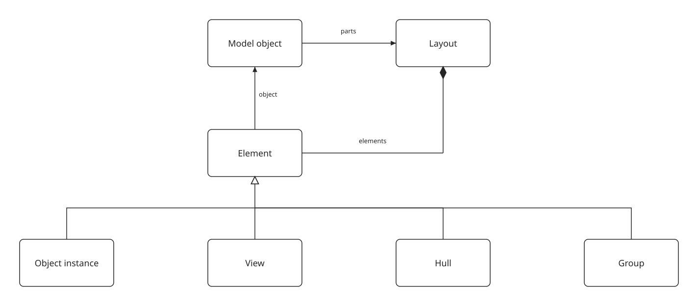

# Group, object, view and hull: design

Status: written and built on 2026-11-26 in [dxos/dxos#14675](https://github.com/dxos/dxos/pull/14675). Sections 1 to
5 describe the model as it is now. Section 6 is the decisions, and section 7 says what of them is built and what is
not. [VIEWS.md](./VIEWS.md) holds the earlier reasoning for Views and Objects in the 2D engine; this document adds
the scene model (`@dxos/scene`), 3D, and hulls.

## 1. Summary

The drawing has four ways to put elements inside another element.

| Mechanism  | Purpose                                                           |
| ---------- | ----------------------------------------------------------------- |
| **Group**  | Treat a selection as one thing, where it stands.                  |
| **Object** | A reusable definition, drawn wherever it is placed.               |
| **View**   | A place to drill into, with its own coordinate space.             |
| **Hull**   | A border round nodes that stay selectable and movable one by one. |

All four are stored as the same three records, and one field tells them apart: the kind of the model object the
element places. One function reads it, `containerOf` in `@dxos/scene`.

## 2. The shared model



An **element** of a layout places a **model object**. An object with `parts` names another **layout**, whose elements
are drawn through the placing element. The four mechanisms are four ways to fill in these records.

```ts
// @dxos/scene (Scene.ts, element.ts, document.ts), reduced to the fields that matter here.
type Layout = {
  id: string;
  model?: string; // the model whose objects its elements place
  elements: Record<string, Element>;
  kind?: 'view' | 'composite'; // 'composite' for a group's, a hull's and an Object's parts
  anonymous?: boolean; // a group's or a hull's parts
};

type ModelObject = {
  id: string;
  kind: 'group' | 'hull' | 'view' | string; // any other kind with parts is an Object
  parts?: string; // a layout id; in ECHO, a Ref to the Layout
};

type Element = {
  id: string;
  kind?: string; // how the 2D engine draws it: 'view', 'instance', or a kind with a template
  object?: string; // a model object id
  center?: Point; // 2D and 3D
  size?: Size; // 2D
  scale?: Point; // parts' units to the layout's
  fit?: 'fit' | 'fill' | 'none'; // 'none' draws the parts at true size
  hull?: HullShape; // the border a hull draws
  parent?: string; // editor only: the hull a node is inside
};

type Container = 'group' | 'hull' | 'view' | 'object';
const containerOf: (doc: SceneDocument, layout: Layout, id: string) => Container | undefined;
```

Three rules hold for every mechanism.

1. **Resolve.** `resolve2D` and `resolve3D` apply the object to the element. The element's own fields win, and
   `parts` comes from the object.
2. **Name.** The object's kind names the container. The element's kind is only how the 2D engine draws it.
3. **Place.** A placed composite's box in 2D is its parts' bounds at `scale` about `center` (`scaledFrame` in
   `viewport2d/render-list.ts`). An element with no `center` is placed at the origin at scale 1. 3D does the same
   (`three/render-list.ts`).

## 3. The four cases in the data model

Each example starts from A → B → C in a layout `root` whose model is `m`. Only the fields that tell the cases apart
are shown.

### 3.1 Group

Made by the Group command, which runs the model's `group` intent in a host with a model (plugin-canvas, 2D and 3D).

```ts
// layout root
g: { id: 'g', object: 'root/g', fit: 'none' } // no center: its members are placed from the origin
bc: { kind: 'link', source: { node: 'g', port: 'b' }, target: { node: 'c' } }
// model m
'root/g': { id: 'root/g', kind: 'group', parts: 'root/g' }
// layout root/g
{ kind: 'composite', anonymous: true, model: 'm', elements: { a, b, ab } } // members keep their coordinates
```

Moved or resized on the 2D canvas, the element states the origin and scale its members are placed by:

```ts
g: { id: 'g', kind: 'instance', object: 'root/g', composite: 'root/g', fit: 'none',
     center: { x: 0, y: 64 }, scale: { x: 1, y: 1 } }
```

A group the standalone 2D editor makes (`composeSelection`) has a frame of its own and members relative to its
centre. It places the same kind of object, so every reader treats it as the same group:

```ts
g: { id: '<instance id>', kind: 'instance', object: '<object id>', composite: '<object id>', fit: 'none', center, size }
'<object id>': { kind: 'group', parts: '<object id>' }
```

### 3.2 Object

Made by Make object, which runs the `extract` intent, or placed from the Objects panel.

```ts
// layout root
'object-1': { id: 'object-1', object: 'object-1', center, size } // 2D: its members' bounds; 3D: their mean centre
// model m
'object-1': { id: 'object-1', kind: 'rect', parts: 'object-1-parts' } // 3D: kind 'sphere'
// layout object-1-parts
{ kind: 'composite', model: 'm', elements: { a, b, ab } } // not anonymous
```

2D draws it as an `instance`: its parts scaled into the element's frame by `fit`.

### 3.3 View

Made with the View tool, or written in `.dx` as an object of kind `view`.

```ts
v: { id: 'v', kind: 'view', object: 'detail', scene: 'detail', center, size }
detail: { id: 'detail', kind: 'view', parts: 'detail' }
// layout detail
{ name: 'Detail' } // kind unset, which reads as 'view'
```

### 3.4 Hull

Made by the Hull command. A hull is stored as a group with a border (`utils/hull-group.ts`).

```ts
h: { id: 'hull-1', kind: 'instance', object: 'hull-1-parts', composite: 'hull-1-parts', fit: 'none',
     center, size, hull: 'box', hullInset?: 1 }
'hull-1-parts': { id: 'hull-1-parts', kind: 'hull', parts: 'hull-1-parts' }
// layout hull-1-parts
{ kind: 'composite', anonymous: true, elements: { a, b, ab } } // members relative to the hull's centre
```

The 2D editor never shows that shape. `expandHulls` opens the group on read: A and B stand in the scene with
`parent: 'hull-1'`, and a `hull` node stands for the instance. `collapseHulls` closes it again before a write.

### 3.5 What tells them apart

| Field              | Group       | Object      | View     | Hull        |
| ------------------ | ----------- | ----------- | -------- | ----------- |
| `object.kind`      | `group`     | any other   | `view`   | `hull`      |
| `layout.kind`      | `composite` | `composite` | unset    | `composite` |
| `layout.anonymous` | true        | unset       | unset    | true        |
| `element.fit`      | `none`      | unset or stated | unset | `none`     |
| `element.hull`     | unset       | unset       | unset    | set         |

Only the first row decides. The others follow from it.

### 3.6 Drawings stored before the object said so

The 2D editor used to store every placed object as `{ id: 'view:<layout>' | 'instance:<layout>', kind: 'rect' }`,
and said what it was on the element (`kind: 'view'`, a `hull`) and on the parts layout (`anonymous`). `containerOf`
still reads that, in one place. Such an object is retyped when its node is next written, and by `retypeContainers`
where a whole document is upgraded (`upgradeDocument`).

## 4. Nesting

A container can hold another container: a group of a group and an element, a hull inside a hull, an Object placed in
a group. Three rules make that work.

1. **A frame is derived, to any depth.** A part that has no frame of its own (a group that was never moved) spans
   its own parts. `scaledFrame` recurses, and keeps the layouts it has entered so a cycle stops.
2. **No centre means the origin.** A group stored with no `center` places its members from the origin. A group with
   a `center` and no `size` places them from that centre.
3. **Ungroup carries the placement down.** Ungrouping a group applies its `center` and `scale` to each member. A
   member that is itself a group with no centre takes them as its own (`released` in `model-intent.ts`).

An Object may not be placed inside its own parts (`placesCycle`), and an Object cannot contain a View
(`SPEC-2D.mdl` F-9.9).

## 5. How they behave

| Property            | Group                              | Object                           | View                     | Hull               |
| ------------------- | ---------------------------------- | -------------------------------- | ------------------------ | ------------------ |
| Parts' coordinates  | The parent's                       | Their own, scaled into the frame | Their own space          | The parent's       |
| Named and reusable  | No                                 | Yes                              | A place, opened by nodes | No                 |
| In the Objects panel | No                                | Yes                              | No                       | No                 |
| Edit a member       | Open the group                     | Open the Object                  | Drill in                 | In place           |
| Double-click, 2D    | Opens in isolation                 | Opens in isolation               | Drills in                | Not established    |
| Double-click, 3D    | Not established                    | Drills into the parts            | No `view` node in 3D     | No hull in 3D      |
| Ungroup             | Yes                                | No                               | No                       | Yes                |
| Chrome              | None                               | None in 2D, a frame in 3D        | A frame and a label      | A border           |
| A link from outside | Ends on a port named by the member | Ends on the instance             | Ends on the view node    | Ends on the member |
| Drawn in 3D         | Its members, boxed when selected   | An item, its parts fitted inside | Not built                | Not built          |

## 6. Decisions

Accepted by Rich on 2026-11-26.

1. **The model object's `kind` names the mechanism.** `group`, `hull` and `view` are reserved. Any other object with
   parts is an Object.
2. **The element's `kind` is only how it draws.**
3. **A node names the object it places.** The 2D writers make no `view:` or `instance:` object.
4. **A parts layout is `kind: 'composite'`**, and `anonymous` exactly when its object is a `group` or a `hull`.
5. **Group and Ungroup are the model's intents everywhere**, and Group needs one element or more.
6. **A hull is a group with a border**, and Ungroup takes it apart.
7. **The library shows named Objects only.**
8. **Stored drawings migrate once.**
9. **A selected group shows a box in 3D.**

## 7. What is built

| Decision | State | Where |
| -------- | ----- | ----- |
| 1, 2 | Built | `containerOf` in `scene/src/document.ts`; `toNode` in `viewport2d/render-list.ts`; `three/render-list.ts` |
| 3 | Built | `fromRenderList2D` and `objectPlacing`; `layoutWrites`; plugin-canvas `layout-writer.ts`, `import/tldraw.ts` |
| 4 | Built | `extract` marks its parts layout a composite |
| 5 | Partly | Group is offered for one element. The standalone 2D editor still has its own `composeSelection` and `ungroupInstance` |
| 6 | Built | A hull's object is of kind `hull`; `ungroup` accepts it |
| 7 | Built | `objectEntries` in the editor |
| 8 | Changed | No bulk rewrite: `containerOf` reads the old shape, a write retypes the object, and `retypeContainers` does a whole document |
| 9 | Built | `SceneRenderer3D` outlines a selected group's members and boxes them |

Two decisions were not built as written.

- **5, the standalone editor.** Its Ungroup also carries per-instance part overrides, the instance's layer and fresh
  ids for a named Object placed more than once. The model's reducer has none of these, so replacing it is its own
  change. Both implementations now store the same object kind, and the model's Ungroup takes either group apart.
- **8, the migration.** A stored layout and model migrate one object at a time, and what an object is was said on
  the records round it, which such a migration cannot see.

Consequences to know:

- A `.dx` object with `parts` now draws as an Object in 2D unless its kind is `view`. The sub-scene exemplar says
  `view`.
- Make object draws as an Object where it drew as a View, and its frame is its members' drawn bounds.
- Ungrouping a resized group keeps its members' size.

## 8. Open

1. Move the standalone 2D editor onto the model's Group and Ungroup, and delete `composeSelection`.
2. Double-click on a group in 3D and on a hull in 2D is not established.
3. A hull is not drawn in 3D.
4. `SPEC-2D.mdl` has no feature that states what a hull is.
